# Рендеры WPF-панели

## TZXDATA, этап 8: редактор схемы

`tzxdata-stage8-*.png` получены из настоящего `SchemaEditorWindow` (модальный `ShowDialog`) и меню «⚙»
`PaletteView` на Windows **net48** над `examples/schema.json` и двумя блоками в памяти. Источник:
[CI, commit 7259fb3](https://github.com/konard/veb86-acadPaletteSetXDATA/actions/runs/38980835335),
артефакт `wpf-renders`, папка `net48`; те же проверки пройдены на .NET 8. Описание редактора —
[schema-editor.md](../schema-editor.md).

| Меню «⚙» палитры | «Параметры»: формула `GC_Name` и предпросмотр «ЩУ1.3» |
| --- | --- |
| 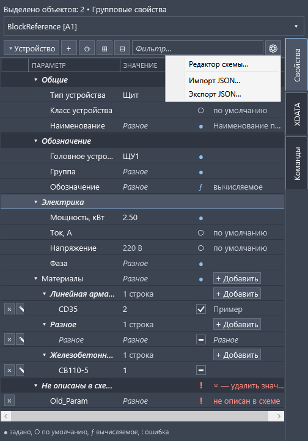 | 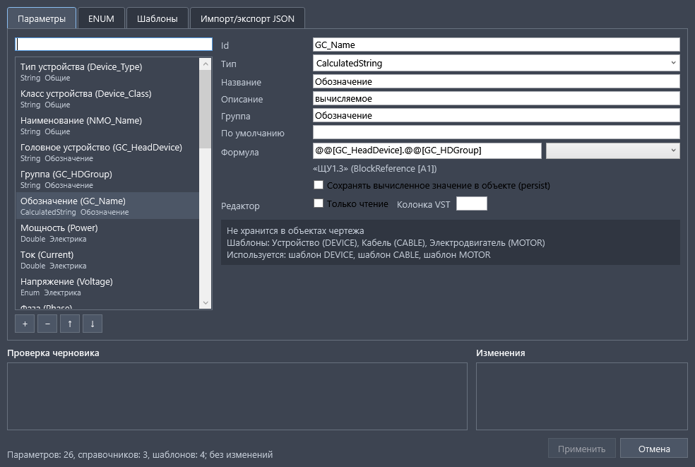 |

| «ENUM»: ключи `Phase` с числом объектов | «Шаблоны»: `DEVICE`, два списка |
| --- | --- |
| 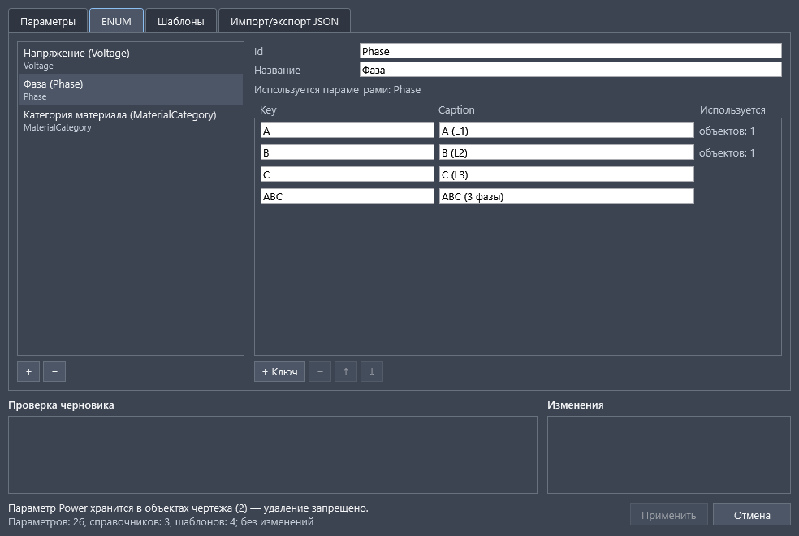 | 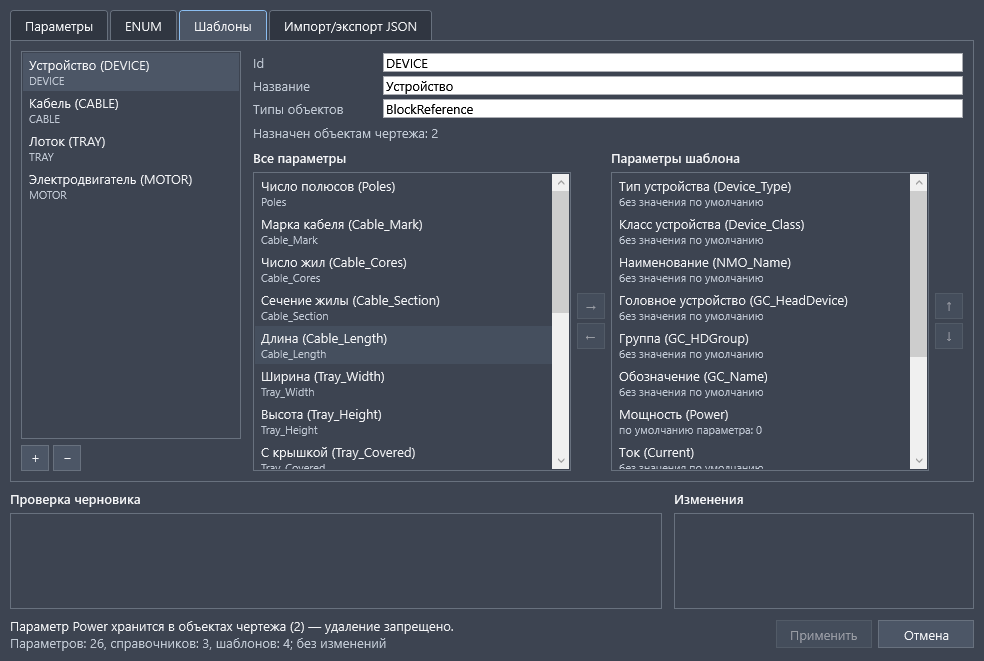 |

| Ошибка `Id` = `1st`: «Применить» недоступна | Импорт-объединение в черновик: конфликт типа `Power` |
| --- | --- |
| 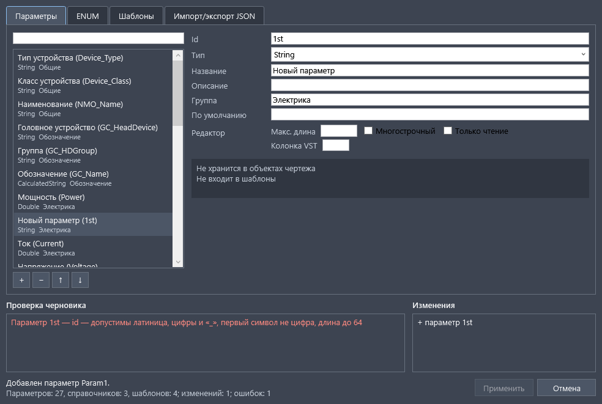 | 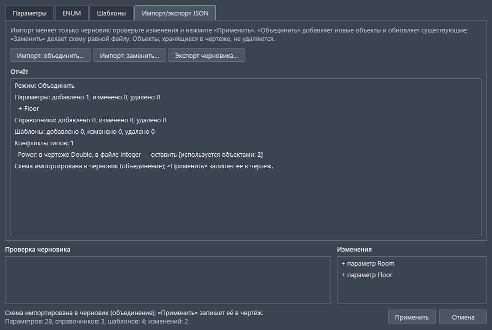 |

| Светлая тема |
| --- |
| 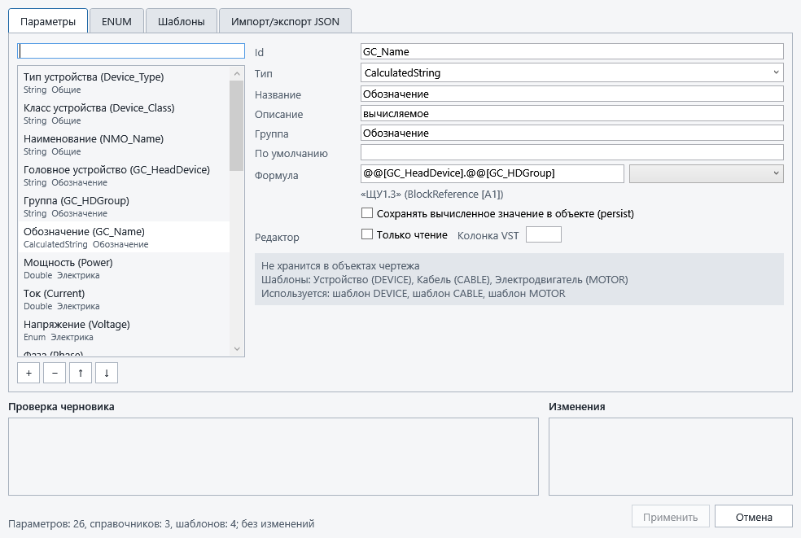 |

Smoke этапа 8 проверяет: меню «⚙» с командами схемы и запуск `VELEC_SCHEMA_EDIT`; открытие на первом
параметре без изменений; предпросмотр формулы на первом выбранном объекте; запрет удаления `Power`,
хранимого в объектах; списки ENUM и шаблона; ошибку `Id` в «Проверке черновика» с недоступной
«Применить»; импорт-объединение с сохранением типа `Power`; «Применить» без вопросов с записью черновика
одной фиксацией NOD, читаемой обратно как экспорт черновика; светлую тему; «Отмена» изменённого
черновика с одним вопросом и без записи.

## TZXDATA, этап 7: шаблоны на объектах

`tzxdata-stage7-*.png` получены из настоящего `PropertyGridView` внутри `PaletteView` на Windows
**net48** после записи через `XDataWriter` в три блока в памяти. Источник:
[CI, commit fec1c41](https://github.com/veb86/acadPaletteSetXDATA/actions/runs/38913551517),
артефакт `wpf-renders/net48`; те же проверки пройдены на .NET 8. Описание шаблонов —
[object-templates.md](../object-templates.md).

| Без шаблона | Меню «Назначить шаблон» |
| --- | --- |
| 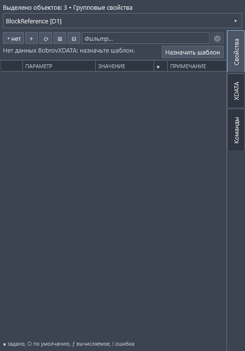 | 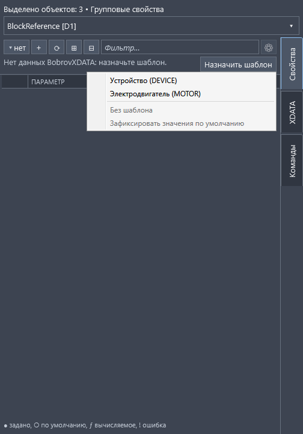 |

| Назначен `MOTOR`: умолчания с `○` | Меню индикатора: отметка, «Зафиксировать значения по умолчанию» | Смена на `DEVICE`: `Poles` в «Дополнительные» |
| --- | --- | --- |
| 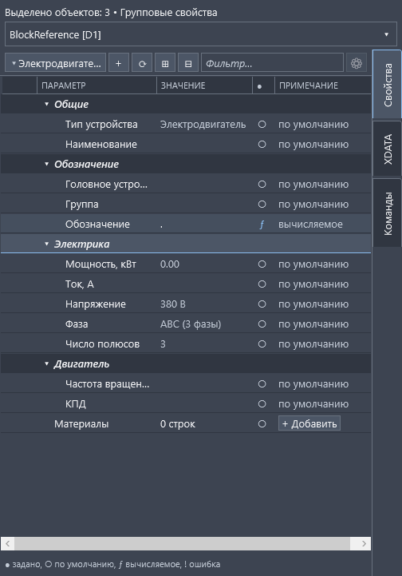 | 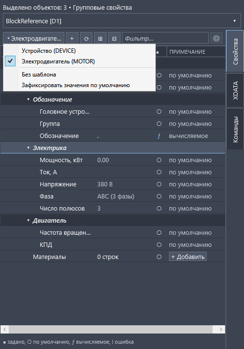 | 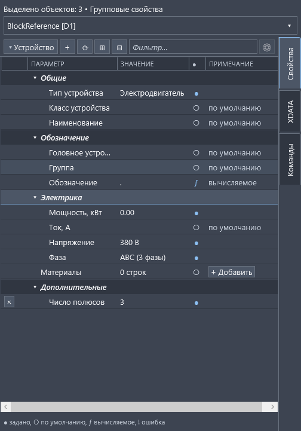 |

Smoke этапа 7 проверяет: кнопку «Назначить шаблон»; меню только с шаблонами `BlockReference`,
открытое внутри палитры; назначение `MOTOR` одной записью с тремя разными `DEVICE_ID`; умолчание
шаблона с `○` без записи; отметку текущего шаблона; фиксацию умолчаний (`●`); смену на `DEVICE` с теми
же `DEVICE_ID`; «Без шаблона» с сохранением значений. Рендер меню собран из палитры и всплывающего
окна `ContextMenu`.

## TZXDATA, этап 6: редактирование в VST

`tzxdata-stage6-*.png` получены из настоящего `PropertyGridView` внутри `PaletteView` на Windows
**net48** после записи через `XDataWriter` в объекты в памяти. Источник:
[CI, commit 62e3374](https://github.com/veb86/acadPaletteSetXDATA/actions/runs/38906631112),
артефакт `wpf-renders/net48`; те же проверки пройдены на .NET 8. Описание редактирования —
[vst-editing.md](../vst-editing.md).

| Тёмная тема, 2 объекта | Светлая тема, 2 объекта |
| --- | --- |
| 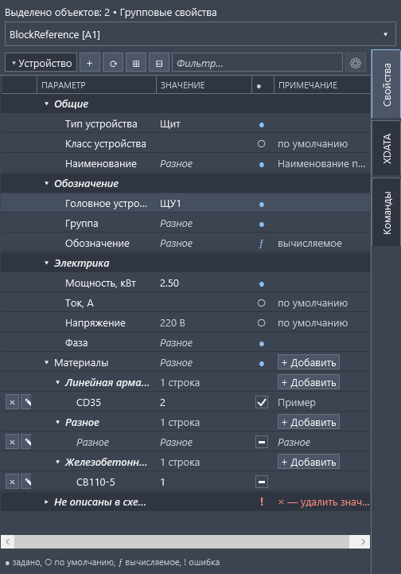 | 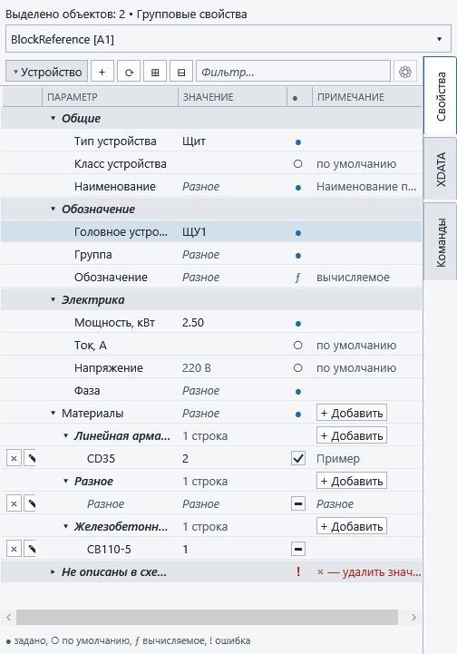 |

| Редактор с единицей `кВт` | Ошибка ввода `-1` | `✎` строки таблицы, ячейка «Кол.» |
| --- | --- | --- |
| 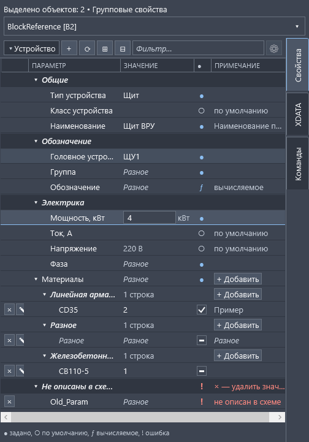 | 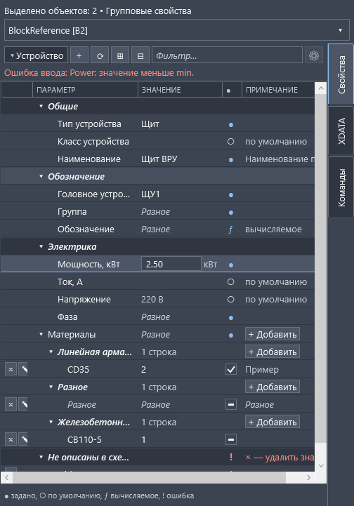 | 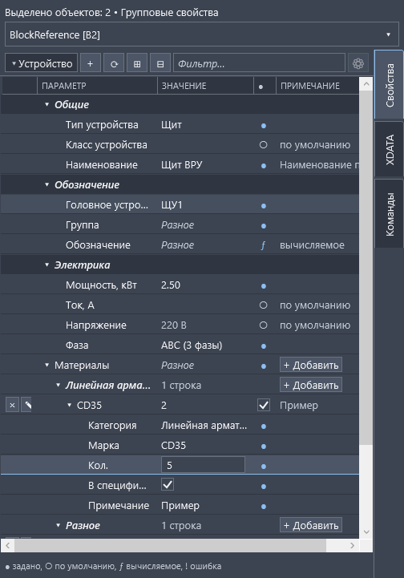 |

| Меню «+ Параметр» | Ошибка записи |
| --- | --- |
| 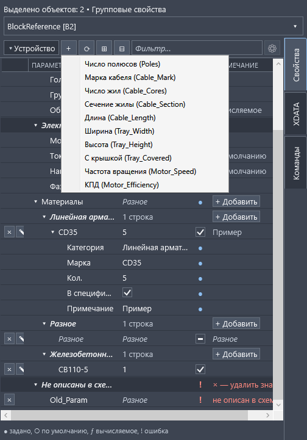 | 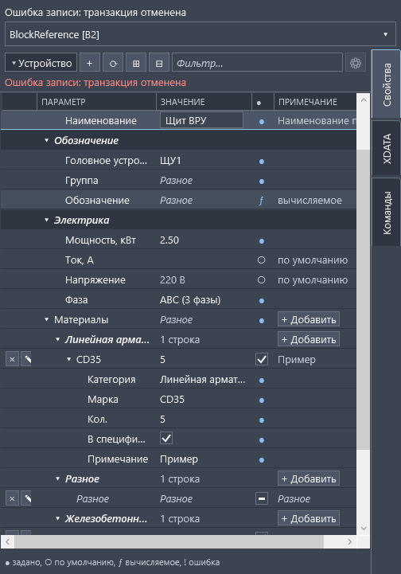 |

| Пустое выделение | Фильтр | Виртуализация, 400+ строк |
| --- | --- | --- |
| 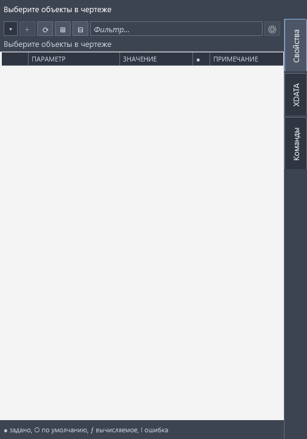 | 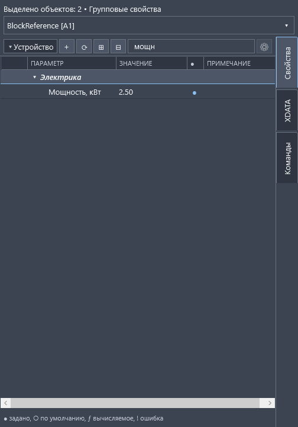 | 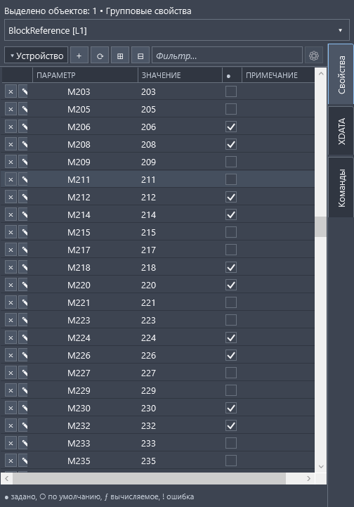 |

| Без шаблона | Прежний формат: только чтение | Минимальный размер 280 × 320 |
| --- | --- | --- |
| 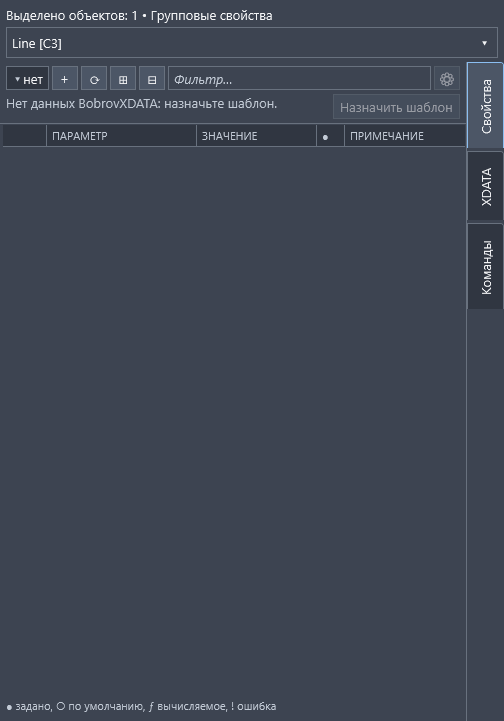 | 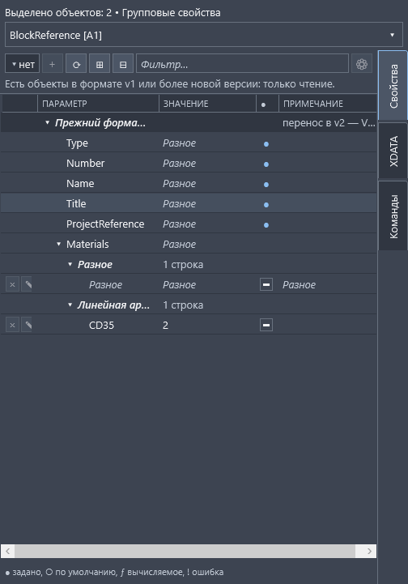 | 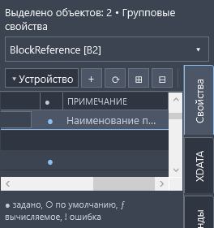 |

Smoke этапа 6 проверяет: редактор только у выделенной строки; Enter без ввода не пишет «Разное»,
ввод + Enter пишет все объекты; Esc; красную ошибку ввода; запись `Enum` из списка;
трёхпозиционный флажок; `✎` и запись ячейки; `+ Добавить` с курсором в ключе и `×`; меню
«+ Параметр» и запись выбранного параметра; ошибку записи с сохранением значений и выделения.
Рендер меню собран из палитры и всплывающего окна `ContextMenu`.

## TZXDATA, этап 5: VST вкладки «Свойства»

`tzxdata-stage5-*.png` получены из настоящего `PropertyGridView` внутри `PaletteView` на Windows
**net48**. Источник: [CI, commit f2cb14b](https://github.com/veb86/acadPaletteSetXDATA/actions/runs/38896199609),
артефакт `wpf-renders/net48`; те же проверки пройдены на .NET 8. Данные — кэш значений по схеме
[`examples/schema.json`](../../examples/schema.json), AutoCAD в CI не запускается. Описание VST —
[vst.md](../vst.md).

| Тёмная тема, 2 объекта | Светлая тема, 2 объекта |
| --- | --- |
| 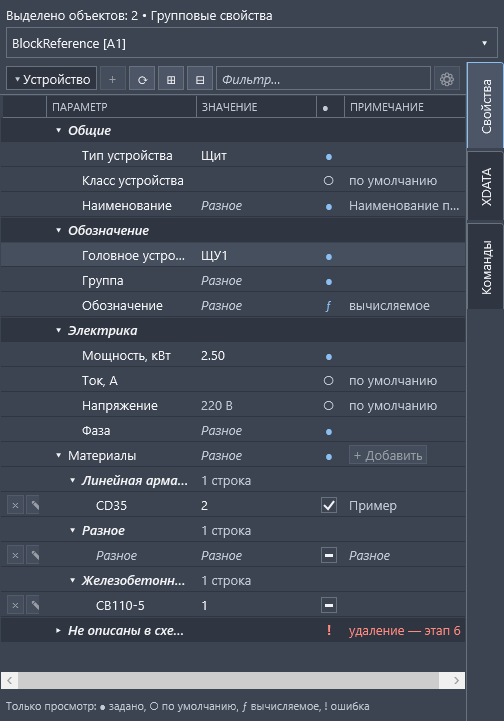 | 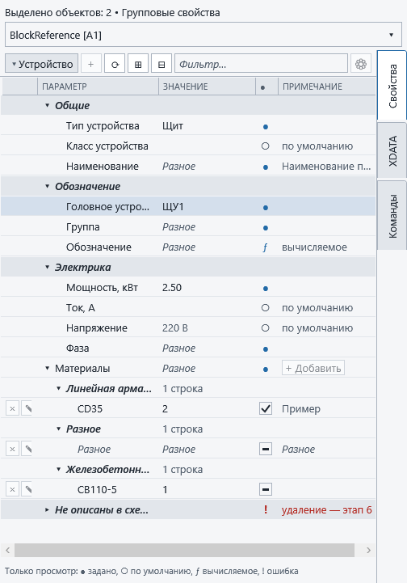 |

| Пустое выделение | Фильтр | Виртуализация, 400+ строк |
| --- | --- | --- |
|  | 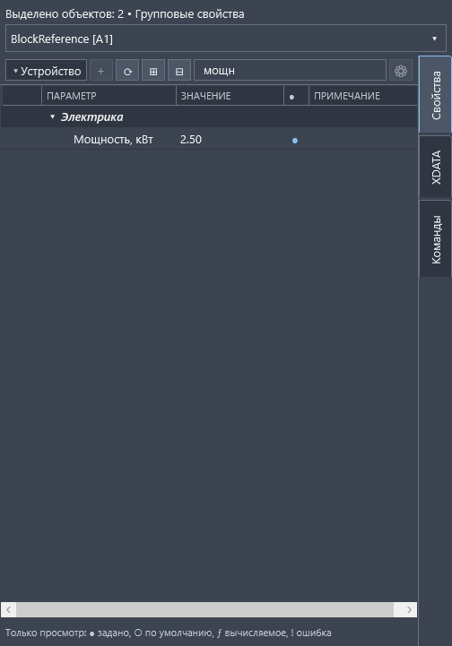 | 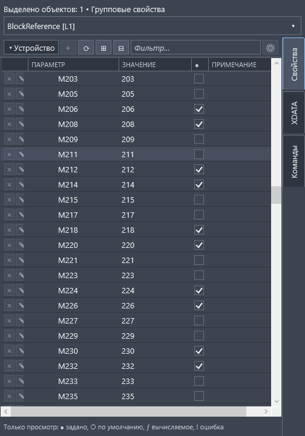 |

| Без шаблона | Прежний формат | Минимальный размер 280 × 320 |
| --- | --- | --- |
| 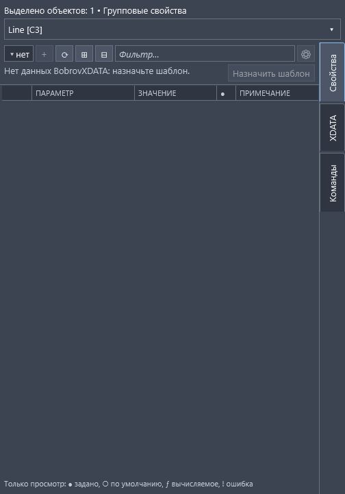 | 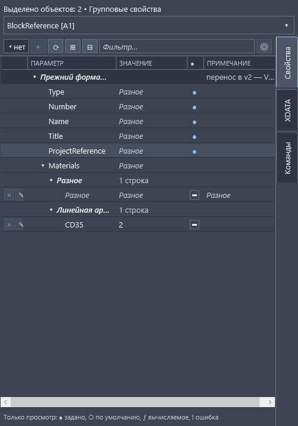 | 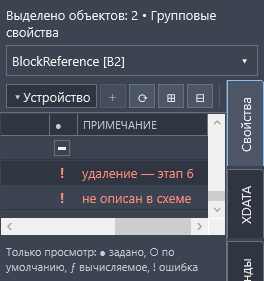 |

Smoke проверяет колонки раздела 8.2, группы и категории таблиц, состояния `●/○/ƒ/!`, «Разное»
серым курсивом, трёхпозиционный флажок, `⟳`/`⊞`/`⊟`, фильтр, меню колонок, сохранение раскрытия
и прокрутки по шаблону, отсутствие ошибок привязок и виртуализацию: видимых контейнеров
`ListViewItem` меньше числа строк.

## Задача #15: панель из единственной Release DLL

`issue15-release-dark.png` / `issue15-release-light.png` получены из WPF-панели,
скомпилированной внутри `acadPaletteSetXDATA.dll`, на Windows **net48**.
Источник: [Release CI, commit 9123f5c](https://github.com/veb86/acadPaletteSetXDATA/actions/runs/37636859030),
артефакт `release-wpf-renders`. Полный smoke-сценарий проверяет шаблоны моделей,
темы, вкладки, дерево и редактирование с теми же общими исходниками, что и отдельная UI DLL.
Собранный ZIP содержит только `acadPaletteSetXDATA.dll`; регистрация `XDATAPALETTE`
проверяется по её метаданным.

| Тёмная тема из Release DLL | Светлая тема из Release DLL |
| --- | --- |
| 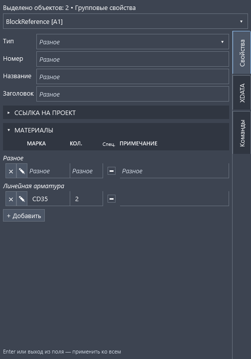 | 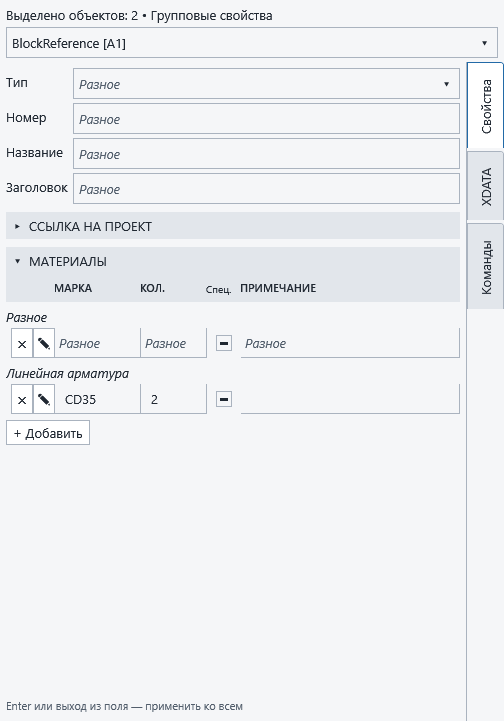 |

Источник данных — снимки двух объектов. AutoCAD в CI не установлен: нативная рамка
PaletteSet, сообщение `NETLOAD` и запуск команды в AutoCAD проверяются отдельно по
[сценарию](../autocad-verification.md).

## Этап 5: запись общего поля с сохранением уникальных данных

`stage5-before.png` / `stage5-after.png` получены из настоящего WPF `UserControl`
на Windows **net48**, целевом runtime AutoCAD 2021. Источник:
[CI, commit 603ec39](https://github.com/veb86/acadPaletteSetXDATA/actions/runs/37540679249),
артефакт `wpf-renders/net48`. Те же проверки проходят на .NET 8.

| До: общий тип «Кабель» | После Enter: общий тип «Устройство» |
| --- | --- |
| 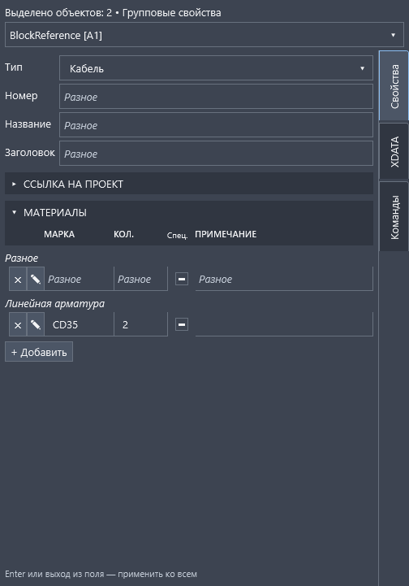 | 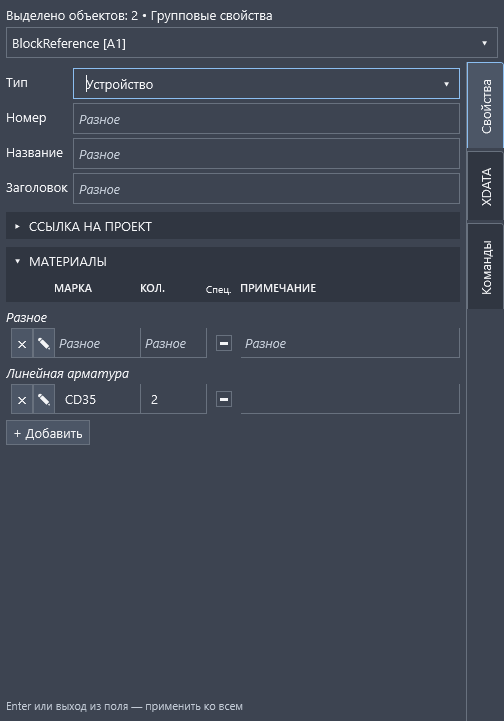 |

Поля названия/номера остаются «Разное», материалы сохраняют индивидуальные значения.
Сценарий использует настоящий `XDataWriter` с транзакцией в памяти; он проверяет
значения обоих снимков после ввода через настоящий ComboBox. Нативная рамка PaletteSet,
живая DWG и стек Undo AutoCAD в этих рендерах не участвуют.

## Этап 4: «Разное» и групповое редактирование

`stage4-*.png` получены из настоящего WPF `UserControl` на Windows **net48**,
целевом runtime AutoCAD 2021. Источник:
[CI, commit 0c7a3cb](https://github.com/konard/veb86-acadPaletteSetXDATA/actions/runs/37511644763),
артефакт `wpf-renders/net48`. Те же проверки проходят для .NET 8.
Источник данных — снимки с mock-записью через настоящий `XDataPatch`, без AutoCAD.

| До: отдельный объект, только чтение | После: общие свойства и Разное |
| --- | --- |
| 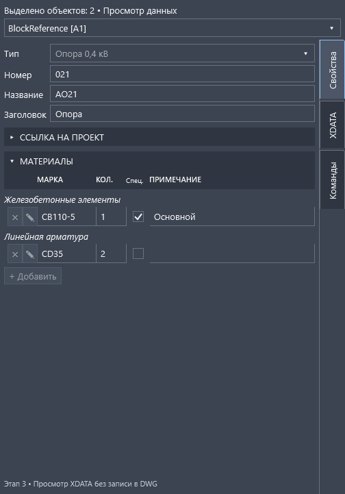 | 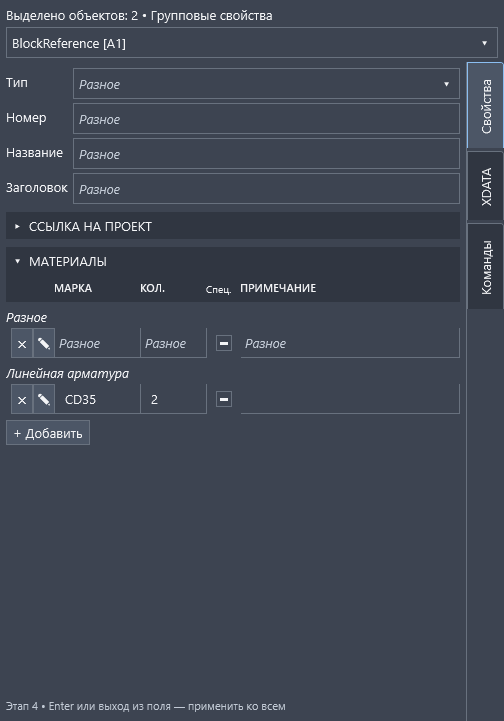 |

| Разное, светлая тема | Подтверждённые групповые изменения |
| --- | --- |
| 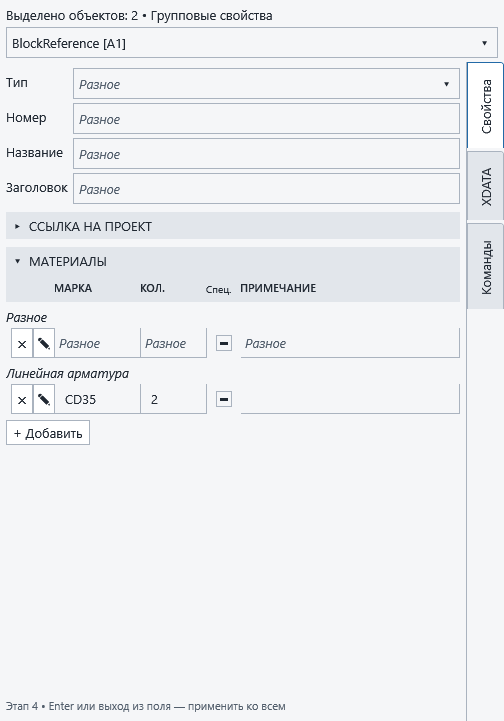 | 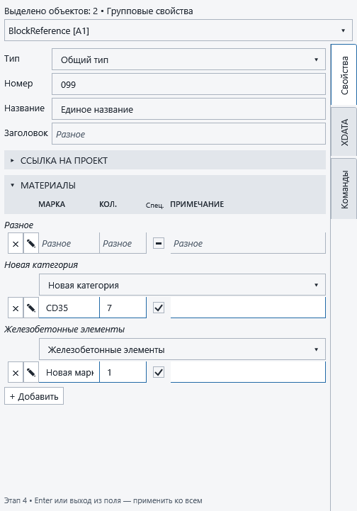 |

Проверяются настоящий ввод/подтверждение через Enter/фокус, отсутствие записи при
посещении поля без ввода, полная видимость плейсхолдера количества, сохранение фокуса
при вводе категории, перегруппировка после подтверждения, флаг и material add/rename/delete.
Нативная рамка PaletteSet и запись/Undo в живой DWG проверяются отдельно в AutoCAD.

## Этап 3: выбор и чтение XDATA/XRecord

`stage3-*.png` получены из настоящего WPF `UserControl` на Windows в режиме чтения.
Источник: [CI, commit 685632c](https://github.com/veb86/acadPaletteSetXDATA/actions/runs/37477965743),
артефакт `wpf-renders/net8`. Те же проверки выполняются на .NET Framework 4.8,
который используется целевой сборкой AutoCAD 2021. AutoCAD в CI не установлен:
рендеры используют снимки двух примитивов, без нативной рамки PaletteSet.

| Тёмная тема | Светлая тема |
| --- | --- |
|  | 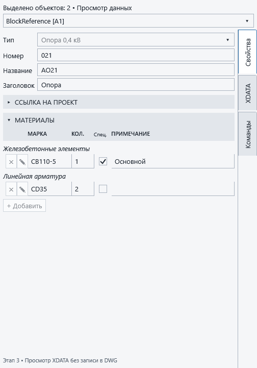 |
| 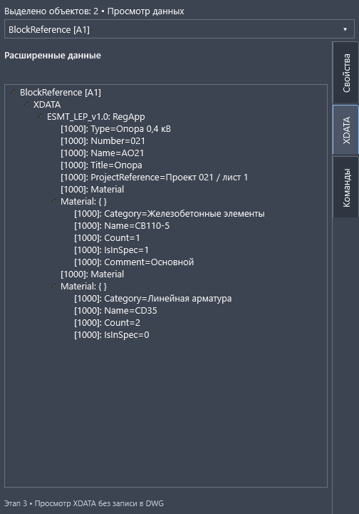 | 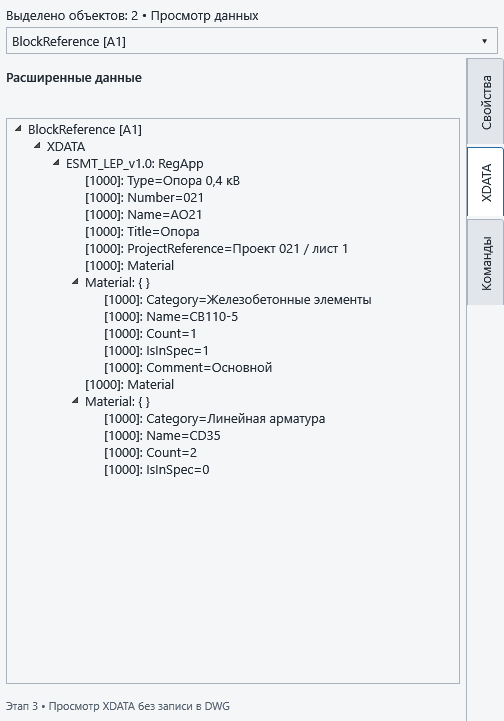 |

| Без выделения: редактор неактивен | Один объект | XML XRecord |
| --- | --- | --- |
| 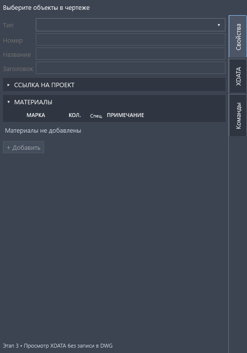 | 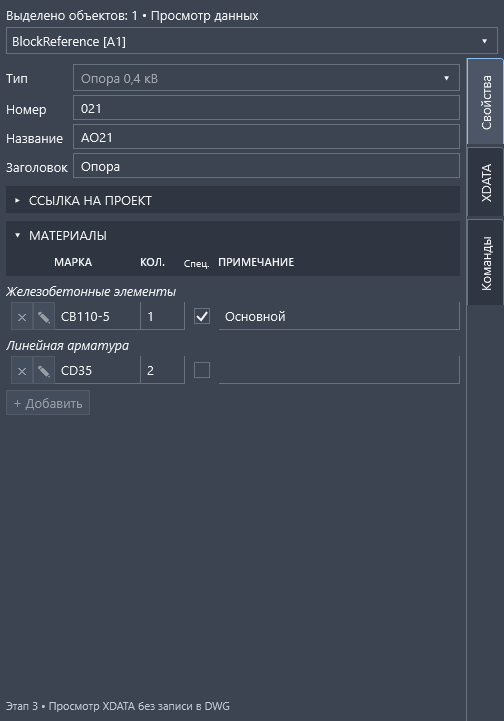 | 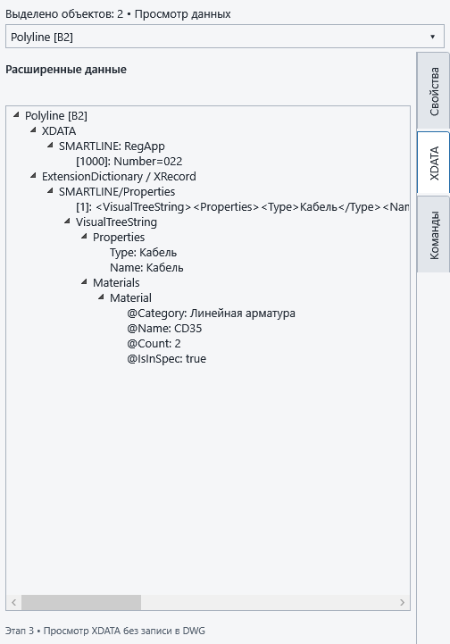 |

Проверка подписи выбранного объекта выявила отсутствие `SelectionBoxItemTemplate`
в общем шаблоне ComboBox. До исправления выводилось CLR-имя модели, после — тип
примитива и handle. Smoke-тест на commit `ef10578` воспроизводит ошибку;
проверка обеих подписей при смене объекта выполняется в обеих темах и платформах.

| До исправления подписи | После |
| --- | --- |
| 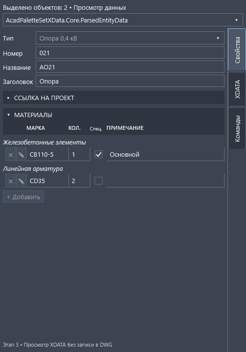 |  |

## Этап 2: свойства и материалы

`stage2-*.png` созданы настоящим WPF `UserControl` на Windows, включая пустой
черновик, три вкладки в обеих темах, раскрытый проект и узкую панель с прокруткой.
В обычных изображениях инструмент предпросмотра использует демонстрационные
материалы из изображения ТЗ; сам плагин начинает с пустого черновика.

Источник: [CI, commit ad6f6fe](https://github.com/konard/veb86-acadPaletteSetXDATA/actions/runs/37452804483),
артефакт `wpf-renders/net8`. Тот же сценарий проверяет .NET Framework 4.8.
Генератор: `experiments/AcadPaletteSetXData.WpfSmoke`; команды — в основном README.
Изображения показывают WPF-содержимое без нативной рамки AutoCAD.

| Тёмная тема | Светлая тема |
| --- | --- |
| 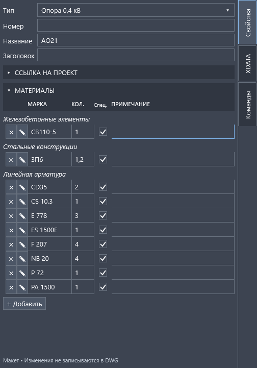 | 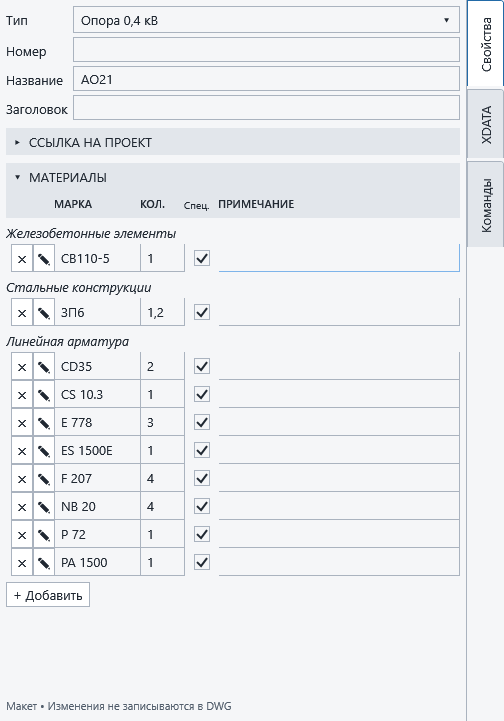 |
| 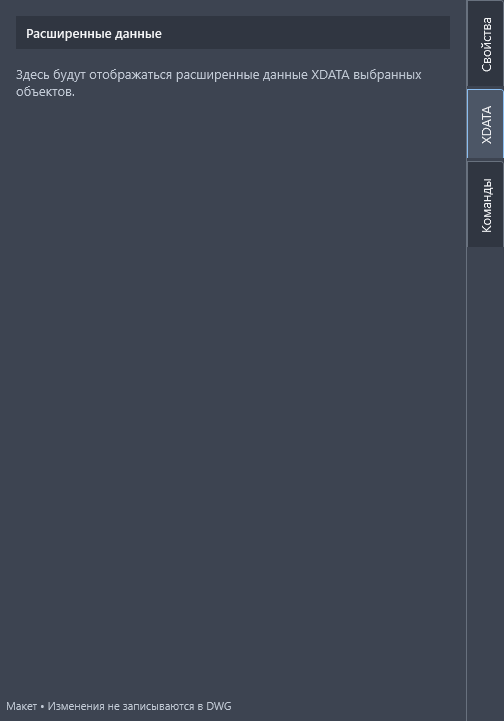 |  |
|  |  |

| Пустой черновик | Ссылка на проект | Минимальный размер, прокрутка |
| --- | --- | --- |
|  |  |  |

## Этап 1: исходный каркас

Изображения `stage1-<тема>-<вкладка>.png` созданы настоящим WPF `UserControl`
на Windows, а не отдельным макетом. Индексы вкладок: `0` — «Свойства»,
`1` — «XDATA», `2` — «Команды». Здесь сохранены рендеры .NET 8; тот же сценарий
успешно выполнен и на .NET Framework 4.8.

Источник: [CI, commit 378f034](https://github.com/konard/veb86-acadPaletteSetXDATA/actions/runs/37442186241),
артефакт `wpf-renders/net8`. Генератор: `experiments/AcadPaletteSetXData.WpfSmoke`.
Изображения показывают только содержимое палитры, без нативной рамки AutoCAD.

| Тёмная тема | Светлая тема |
| --- | --- |
|  |  |
|  |  |
|  |  |
