# Рендеры WPF-панели

## Задача #72. Импорт и экспорт профилей навигатора

Меню ⚙ вкладки «Навигатор» с командами «Импорт JSON…» и «Экспорт JSON…». Рендер получен из выпускаемой
DLL в WPF-проверке `VerifyNavigatorProfileFiles`. [Запуск CI](https://github.com/veb86/acadPaletteSetXDATA/actions/runs/46000464234).

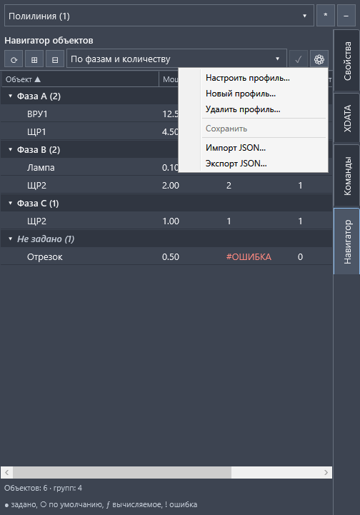

## Задача #70. Список выделения и копирование свойств

- До исправления список скрывался [без выделения](issue70-before-empty.png) и смещал вкладки и VST
  [при выделении](issue70-before-selected.png).
- После исправления список показывает [подсказку](issue70-after-empty.png) или
  [группу и количество](issue70-after-selected.png), а вкладки и VST сохраняют положение.
- [Меню параметра](issue70-property-copy-menu.png) открывается по имени или значению.

Рендеры `net48` из артефактов `wpf-renders` до и после изменения. [Исходный запуск CI](https://github.com/veb86/acadPaletteSetXDATA/actions/runs/45967484011), [запуск с исправлением](https://github.com/veb86/acadPaletteSetXDATA/actions/runs/45968889100).

## Задача #68: выделение устройства и группы в навигаторе

`issue68-navigator-group-menu.png` — правая кнопка на группе «ЩР (3)»: строка группы выбрана, открыто меню
«Выделить все устройства группы (3)»; пункт выделяет в чертеже все три объекта группы на всех уровнях.
У листа меню нет, у заголовка колонок остаётся меню колонок.

Источник — [CI, commit 6e04628](https://github.com/konard/veb86-acadPaletteSetXDATA/actions/runs/45954048718),
артефакт `wpf-renders`, папка `net48`; те же проверки пройдены на .NET 8. Генератор —
`VerifyNavigatorGroupSelection` в `experiments/AcadPaletteSetXData.WpfSmoke`. Описание — [navigator.md](../navigator.md).

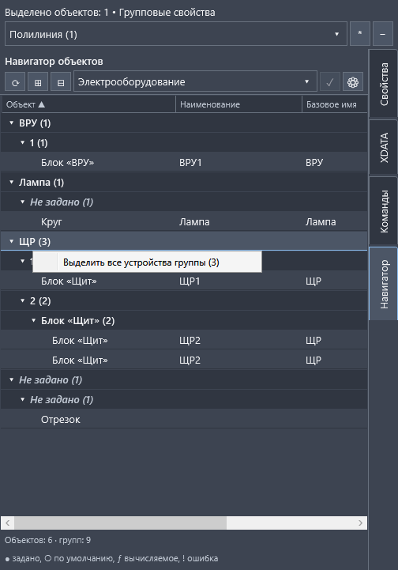

## Задача #66: вкладка «Навигатор»

`issue66-*.png` — настоящие `PaletteView` с `NavigatorView` и `NavigatorProfileWindow` на Windows **net48**
без AutoCAD, на объектах примера [issue66-navigator.lsp](../../examples/issue66-navigator.lsp) и профилях
[examples/navigator](../../examples/navigator).

- `issue66-navigator-dark.png`, `issue66-navigator-light.png` — профиль «Электрооборудование»
  (`-DB_link|-DESC_MountingParts|+NMO_BaseName|+NMO_Suffix|-@@[NMO_Name]`) в обеих темах. Видны группы по
  базовому имени и суффиксу, автогруппа «Блок «Щит» (2)», группы «Не задано» и листы, названные по типу объекта.
- `issue66-navigator-erased.png` — выбор листа, объект которого удалён из чертежа: сообщение над деревом.
- `issue66-navigator-columns.png` — колонки, изменённые мышью: заголовок «Мощность» перетащен влево и
  расширен до 150, через меню заголовка скрыта «Фаза» и показана «Связь» (правее, за горизонтальной прокруткой), дерево
  отсортировано по «Объект ▲». Кнопка `✓` активна: изменения колонок ещё не сохранены в профиле.
- `issue66-navigator-by-phase.png` — профиль «По фазам» (`+Phase|+NMO_BaseName|+@@[NMO_Name] (@@[Power] кВт)`):
  деление на ноль в колонке «На единицу» показано красным «#ОШИБКА».
- `issue66-profile-window-dark.png`, `issue66-profile-window-light.png` — окно «Настроить профиль…»
  с добавленной колонкой и разбором выражения по уровням; `issue66-profile-error.png` — ошибка выражения
  блокирует «ОК».

Источник — [CI, commit 06f5527](https://github.com/veb86/acadPaletteSetXDATA/actions/runs/45848207334),
артефакт `wpf-renders`, папка `net48`; те же проверки пройдены на .NET 8. Генератор — `VerifyNavigator`
в `experiments/AcadPaletteSetXData.WpfSmoke`. Описание — [navigator.md](../navigator.md).

| Тёмная тема | Светлая тема |
| --- | --- |
| 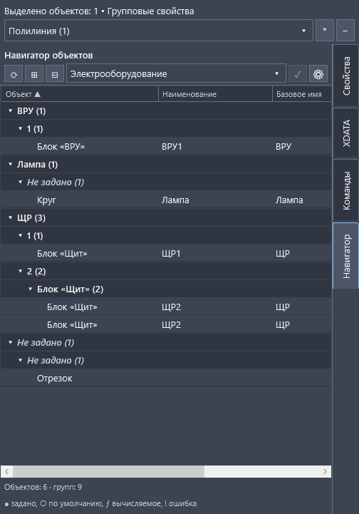 | 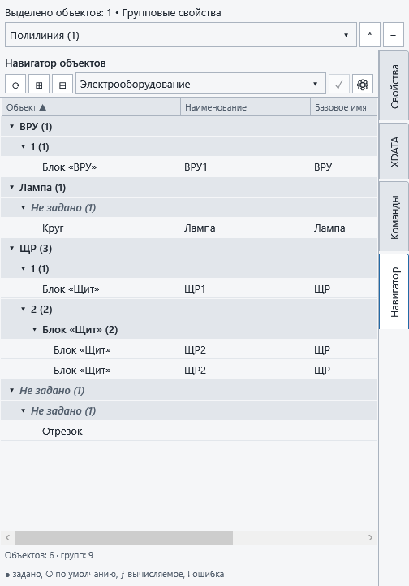 |

| Профиль «По фазам» | Колонки и сортировка |
| --- | --- |
| 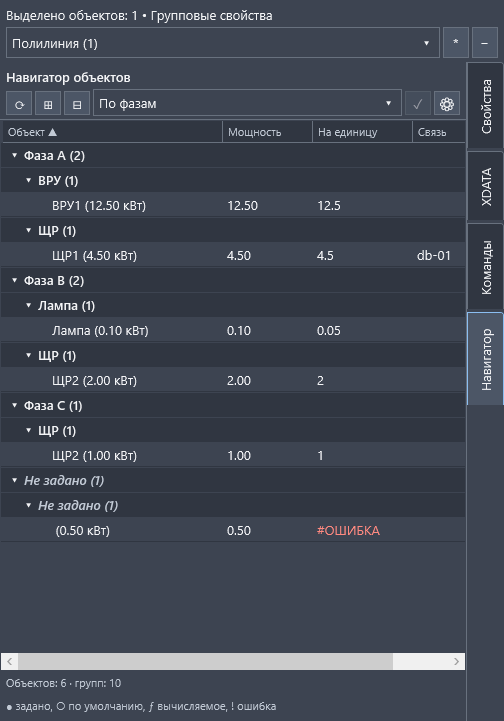 | 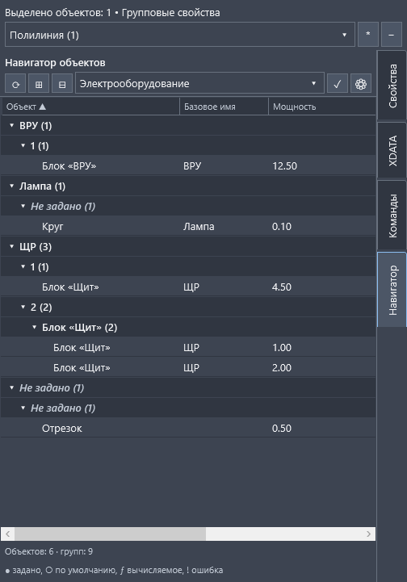 |

| Окно профиля | Ошибка выражения |
| --- | --- |
| 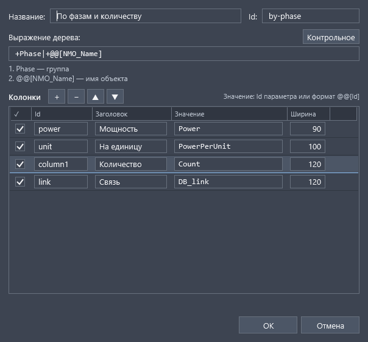 | 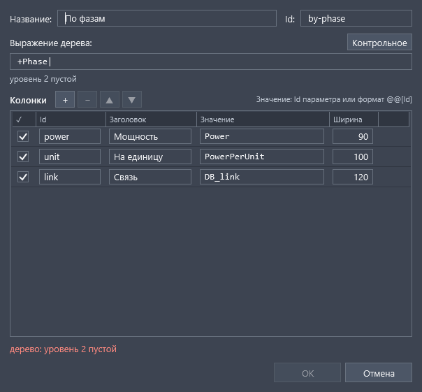 |

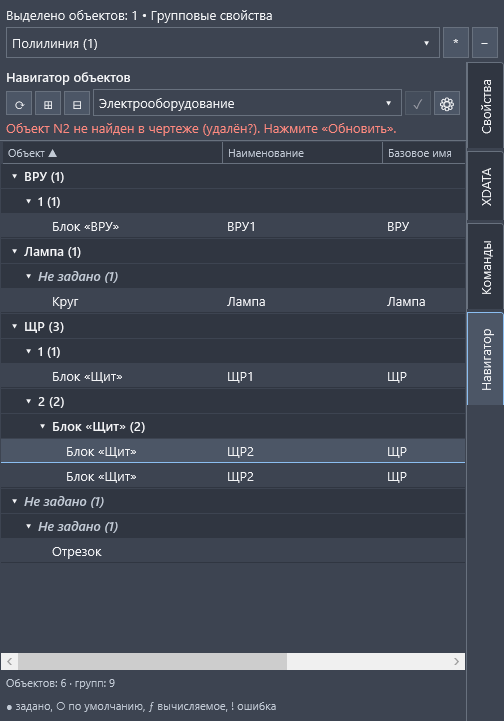
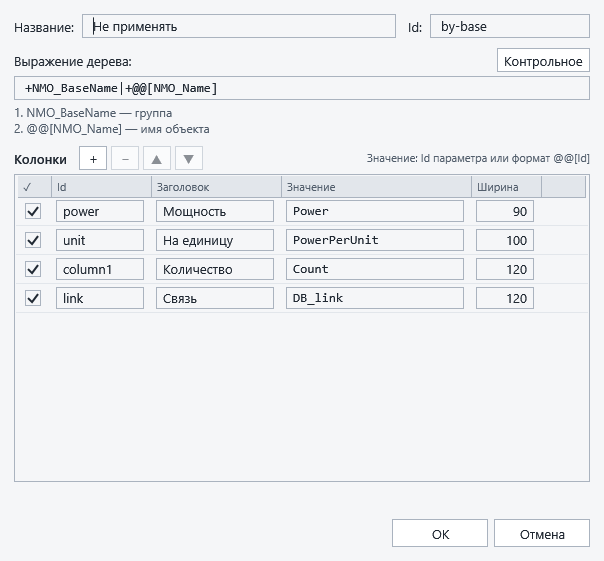

## Задача #59: предел количества выделенных объектов

`issue59-*.png` — настоящие `SettingsWindow` и `PaletteView` на Windows **net48** без AutoCAD.
`issue59-settings-limit.png` — раздел «Выделение» окна настроек с пределом `1` в черновике;
`issue59-over-limit.png` — панель после «ОК»: выделено 2 объекта, это больше предела, объекты не
прочитаны, панель показывает сообщение вместо свойств. Источник —
[CI, commit 5002655](https://github.com/konard/veb86-acadPaletteSetXDATA/actions/runs/43842605194),
артефакт `wpf-renders`, папка `net48`; те же проверки пройдены на .NET 8. Рендеры `issue48-settings-*.png`
обновлены из того же запуска: окно настроек стало выше на раздел «Выделение». Генератор —
`VerifySelectionLimit` в `experiments/AcadPaletteSetXData.WpfSmoke`. Описание —
[settings.md](../settings.md).

| Предел в окне настроек | Выделение больше предела |
| --- | --- |
| 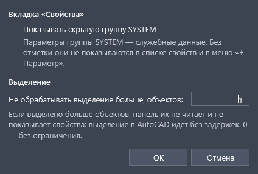 | 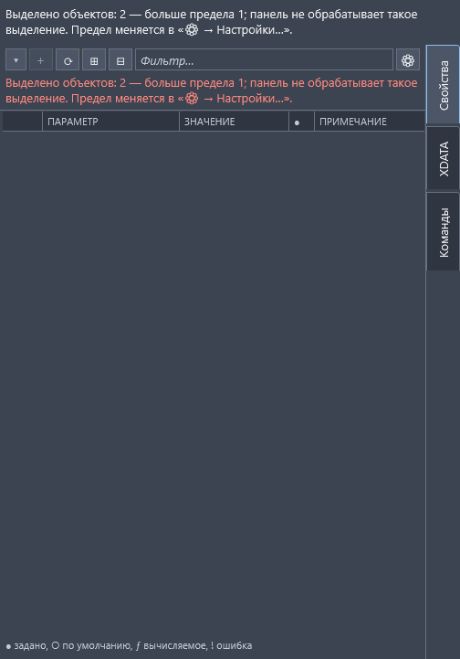 |

## Задача #50: кнопка «Ок» значения по умолчанию в шаблоне

`issue50-template-default-ok.png` — вкладка «Шаблоны» настоящего `SchemaEditorWindow` на Windows **net48**
без AutoCAD: у параметра `Power` шаблона `DEVICE` введено `7.5` и нажата «Ок» справа от поля
«По умолчанию в шаблоне» (высотой с поле, шириной в две его высоты) — значение назначено без перехода
фокуса в списки параметров («переопределено: 7.5»). Источник —
[CI, commit 96f7465](https://github.com/konard/veb86-acadPaletteSetXDATA/actions/runs/43699550752),
артефакт `wpf-renders`, папка `net48`; те же проверки пройдены на .NET 8. Генератор —
`VerifyTemplateDefaultButton` в `experiments/AcadPaletteSetXData.WpfSmoke`. Описание —
[schema-editor.md](../schema-editor.md#вкладки-раздел-9).

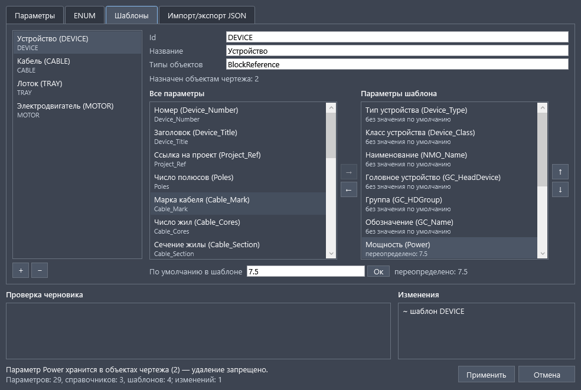

## Задача #43: формула NCalc в редакторе схемы

`issue43-formula-preview.png` — редактор схемы с формулой
`="Щит " & @@[GC_HeadDevice] & "." & @@[GC_HDGroup] & IF(@@[Power] > 2 AND @@[Power] < 10, " P>2", "")`
у `GC_Name`: предпросмотр на выделенном объекте — «Щит ЩУ1.3 P>2». Рендер единственной Release DLL
(`acadPaletteSetXDATA.dll`, NCalc загружен из встроенного ресурса) на Windows **net48** без AutoCAD из
[CI, commit 51d7b68](https://github.com/veb86/acadPaletteSetXDATA/actions/runs/43689183622), артефакт
`release-wpf-renders`; те же проверки пройдены на net48 и .NET 8 со сборкой для разработки
([CI](https://github.com/veb86/acadPaletteSetXDATA/actions/runs/43689183529), `wpf-renders`). Генератор —
`VerifySchemaEditor` и `VerifyFormulaEngine` в `experiments/AcadPaletteSetXData.WpfSmoke`. Описание —
[calculated-string.md](../calculated-string.md#формульный-режим-задача-43).

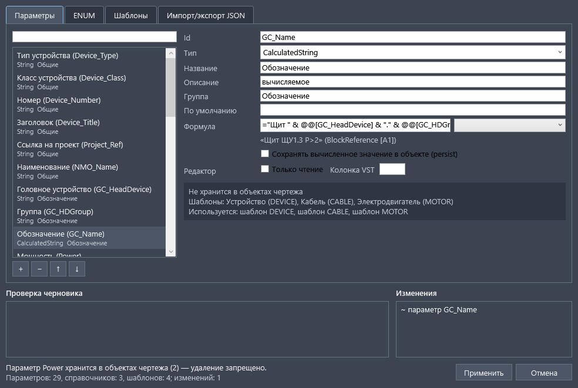

## Задача #48: скрытая группа `SYSTEM`, окно настроек и фон пустого VST

`issue48-*.png` — настоящий `PaletteView` и `SettingsWindow` на Windows **net48** без AutoCAD.
«До» (`issue48-empty-before.png`) — рендер `tzxdata-stage6-empty.png` из
[CI, commit 87fcb72](https://github.com/konard/veb86-acadPaletteSetXDATA/actions/runs/43684344921)
до исправления: неактивный пустой VST белый в тёмной теме. «После» —
[CI, commit 63df5a5](https://github.com/konard/veb86-acadPaletteSetXDATA/actions/runs/43685434423),
артефакт `wpf-renders`, папка `net48`; те же проверки пройдены на .NET 8 (там же рендеры светлой темы
и вкладки «XDATA»). Генераторы — `VerifyEmpty` и `VerifySettings` в `experiments/AcadPaletteSetXData.WpfSmoke`.
Описание — [settings.md](../settings.md).

| Пустой VST, до | Пустой VST, после | Пустой VST, светлая тема | Пустое дерево XDATA |
| --- | --- | --- | --- |
|  |  | 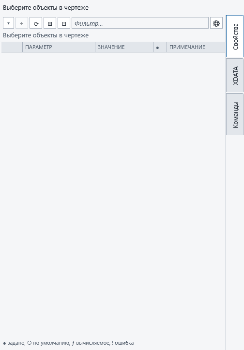 | 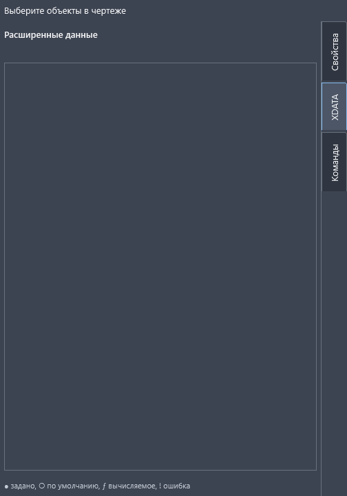 |

| `SYSTEM` скрыта | Окно настроек | `SYSTEM` показана | Окно, светлая тема |
| --- | --- | --- | --- |
| 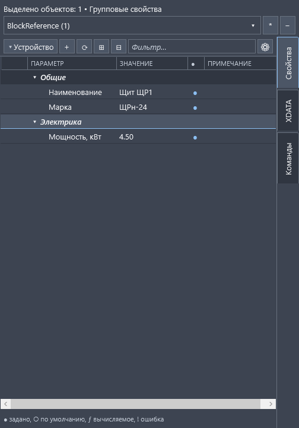 |  | 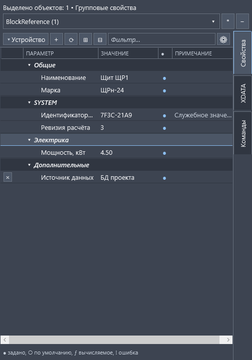 |  |

## Задача #44: текст выпадающего списка `Enum` в VST

`issue44-enum-*.png` — строка «Фаза» настоящего `PropertyGridView` на Windows **net8**, увеличенная в 4 раза
(`SaveZoomed`), с открытым редактором `Enum`: значение «ABC (3 фазы)» и заполнитель «Разное» двух объектов.
«До» — [CI, commit 9596883](https://github.com/konard/veb86-acadPaletteSetXDATA/actions/runs/43681948053)
с временно отменённым исправлением: у текста 13 px на строку 17 px, буквы обрезаны, проверка падает.
«После» — [CI, commit 4c22491](https://github.com/konard/veb86-acadPaletteSetXDATA/actions/runs/43682046040),
артефакт `wpf-renders`, папка `net8`; те же проверки пройдены на .NET Framework 4.8. Генератор —
`ChoiceTextProblem` в `experiments/AcadPaletteSetXData.WpfSmoke`. Описание — [vst-editing.md](../vst-editing.md).

| | Значение | «Разное» |
| --- | --- | --- |
| До |  |  |
| После |  |  |

## Задача #41: список выделенных объектов, `*` и `−`

`issue41-*.png` — настоящий `PaletteView` на Windows **net48** без AutoCAD: семь объектов в памяти,
три с `SYSTEMTYPE` «Опора» (v2, v1, полилиния), полилиния с пустым `SYSTEMTYPE` и объекты без него.
Имена типов «Полилиния», «Отрезок», «Вхождение блока» в рендере заданы данными проверки — так их
возвращает русский AutoCAD; плагин берёт их у AutoCAD. Источник:
[CI, commit 60b139f](https://github.com/veb86/acadPaletteSetXDATA/actions/runs/43636519842),
артефакт `wpf-renders`, папка `net48`; те же проверки пройдены на .NET 8. Генератор —
`VerifySelectionGroups` в `experiments/AcadPaletteSetXData.WpfSmoke`. Описание —
[selection-groups.md](../selection-groups.md).

| Список групп, `Все (7)` | `−` для «Полилиния» | `*` для «Опора» |
| --- | --- | --- |
| 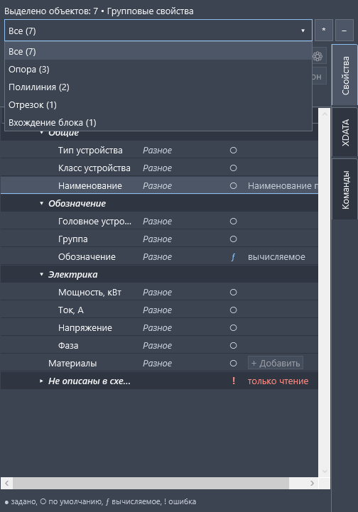 | 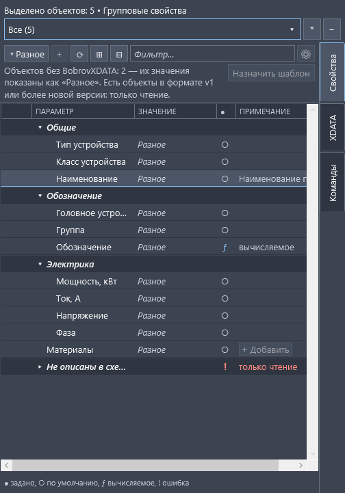 | 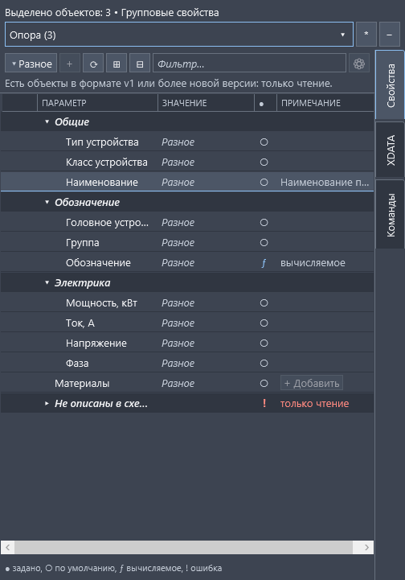 |

## TZXDATA, этап 8: редактор схемы

`tzxdata-stage8-*.png` получены из настоящего `SchemaEditorWindow` (модальный `ShowDialog`) и меню «⚙»
`PaletteView` на Windows **net48** над `examples/schema.json` и двумя блоками в памяти. Источник:
[CI, commit 7259fb3](https://github.com/konard/veb86-acadPaletteSetXDATA/actions/runs/38980835335),
артефакт `wpf-renders`, папка `net48`; те же проверки пройдены на .NET 8. Описание редактора —
[schema-editor.md](../schema-editor.md).

| Меню «⚙» палитры | «Параметры»: формула `GC_Name` и предпросмотр «ЩУ1.3» |
| --- | --- |
| 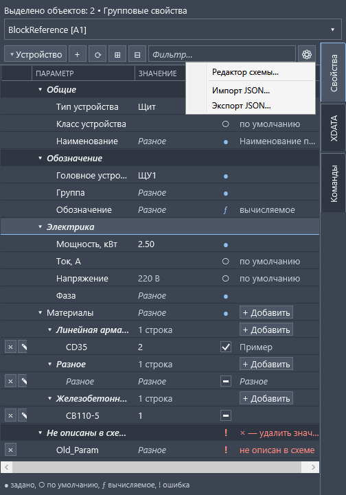 | 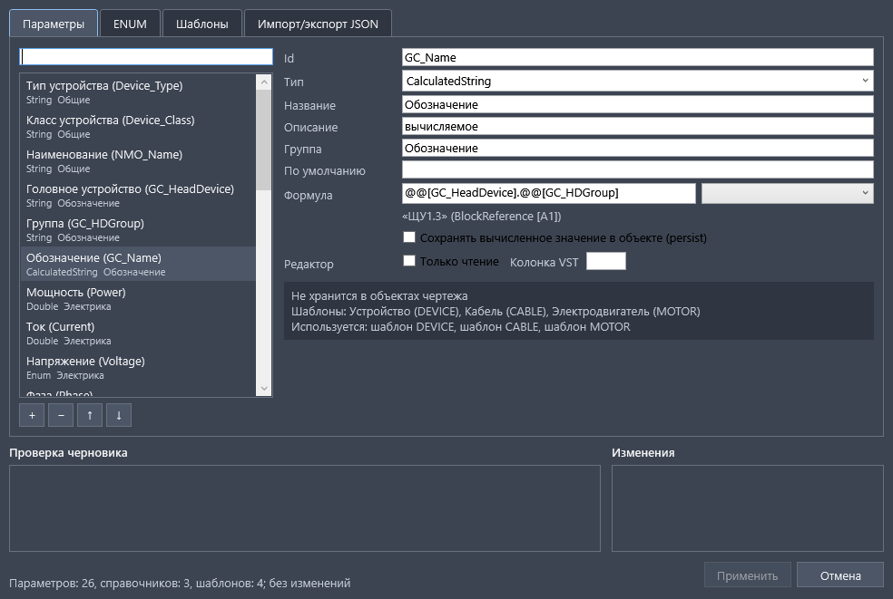 |

| «ENUM»: ключи `Phase` с числом объектов | «Шаблоны»: `DEVICE`, два списка |
| --- | --- |
| 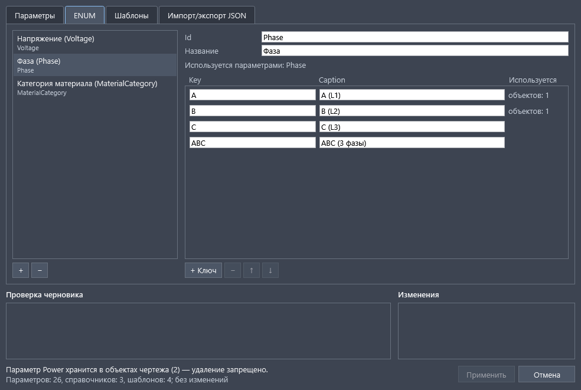 | 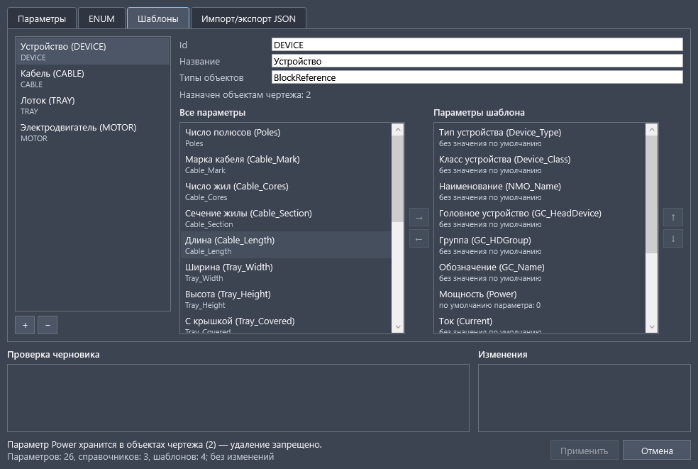 |

| Ошибка `Id` = `1st`: «Применить» недоступна | Импорт-объединение в черновик: конфликт типа `Power` |
| --- | --- |
| 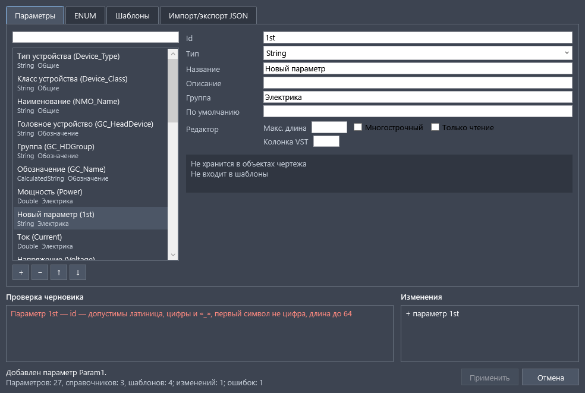 | 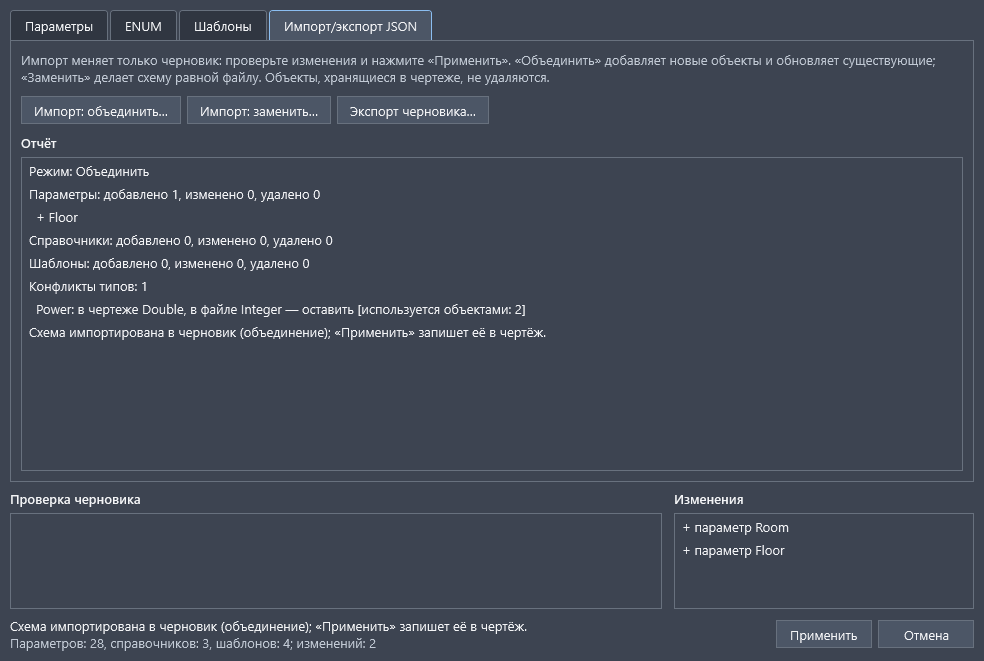 |

| Светлая тема |
| --- |
| 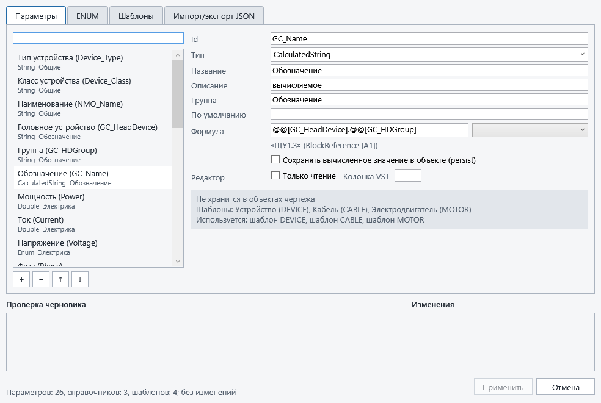 |

Smoke этапа 8 проверяет: меню «⚙» с командами схемы и запуск `VELEC_SCHEMA_EDIT`; открытие на первом
параметре без изменений; предпросмотр формулы на первом выбранном объекте; запрет удаления `Power`,
хранимого в объектах; списки ENUM и шаблона; ошибку `Id` в «Проверке черновика» с недоступной
«Применить»; импорт-объединение с сохранением типа `Power`; «Применить» без вопросов с записью черновика
одной фиксацией NOD, читаемой обратно как экспорт черновика; светлую тему; «Отмена» изменённого
черновика с одним вопросом и без записи.

## TZXDATA, этап 7: шаблоны на объектах

`tzxdata-stage7-*.png` получены из настоящего `PropertyGridView` внутри `PaletteView` на Windows
**net48** после записи через `XDataWriter` в три блока в памяти. Источник:
[CI, commit fec1c41](https://github.com/veb86/acadPaletteSetXDATA/actions/runs/38913551517),
артефакт `wpf-renders/net48`; те же проверки пройдены на .NET 8. Описание шаблонов —
[object-templates.md](../object-templates.md).

| Без шаблона | Меню «Назначить шаблон» |
| --- | --- |
| 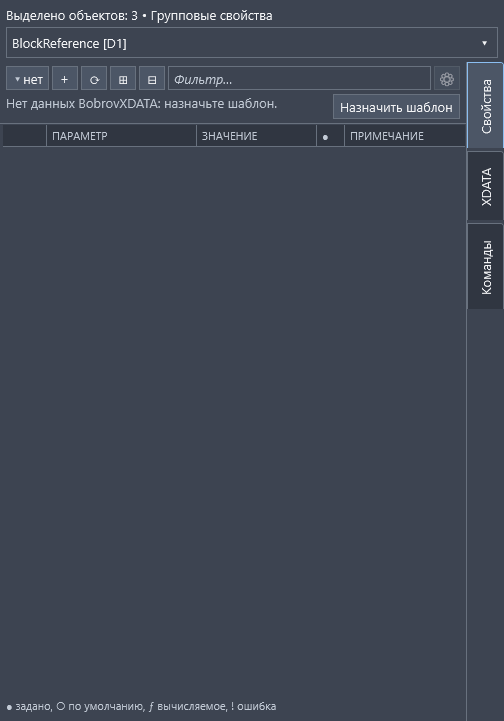 | 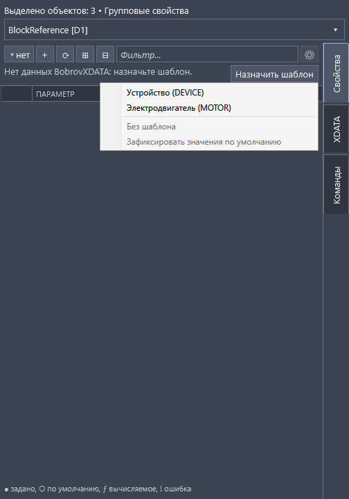 |

| Назначен `MOTOR`: умолчания с `○` | Меню индикатора: отметка, «Зафиксировать значения по умолчанию» | Смена на `DEVICE`: `Poles` в «Дополнительные» |
| --- | --- | --- |
| 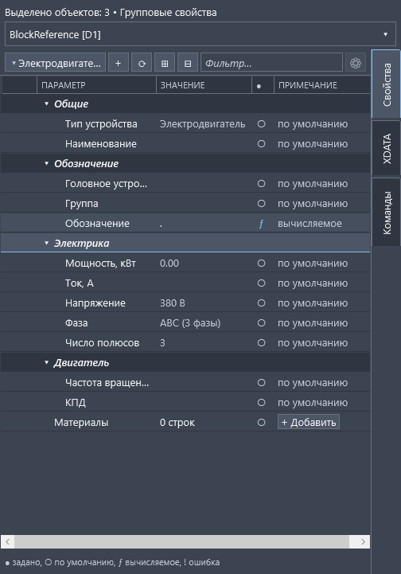 | 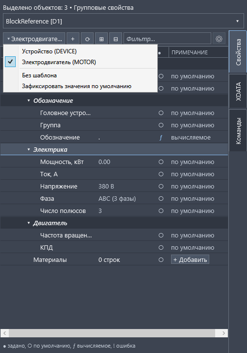 | 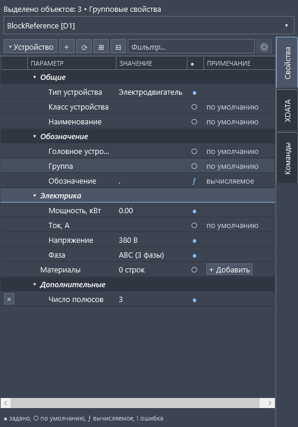 |

Smoke этапа 7 проверяет: кнопку «Назначить шаблон»; меню только с шаблонами `BlockReference`,
открытое внутри палитры; назначение `MOTOR` одной записью с тремя разными `DEVICE_ID`; умолчание
шаблона с `○` без записи; отметку текущего шаблона; фиксацию умолчаний (`●`); смену на `DEVICE` с теми
же `DEVICE_ID`; «Без шаблона» с сохранением значений. Рендер меню собран из палитры и всплывающего
окна `ContextMenu`.

## TZXDATA, этап 6: редактирование в VST

`tzxdata-stage6-*.png` получены из настоящего `PropertyGridView` внутри `PaletteView` на Windows
**net48** после записи через `XDataWriter` в объекты в памяти. Источник:
[CI, commit 62e3374](https://github.com/veb86/acadPaletteSetXDATA/actions/runs/38906631112),
артефакт `wpf-renders/net48`; те же проверки пройдены на .NET 8. Описание редактирования —
[vst-editing.md](../vst-editing.md).

| Тёмная тема, 2 объекта | Светлая тема, 2 объекта |
| --- | --- |
| 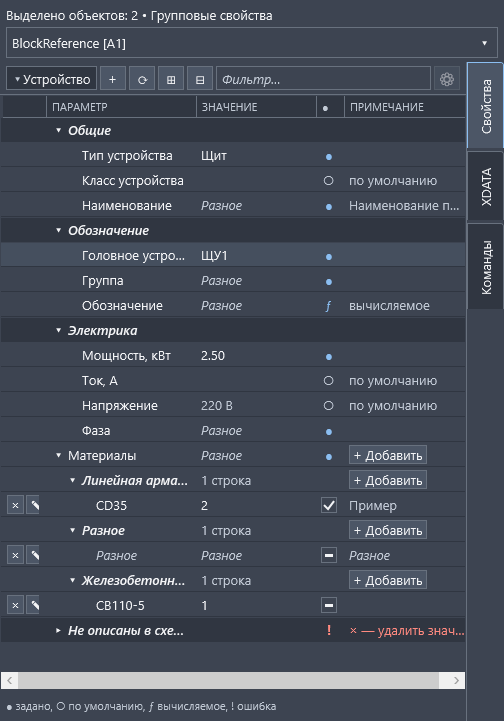 | 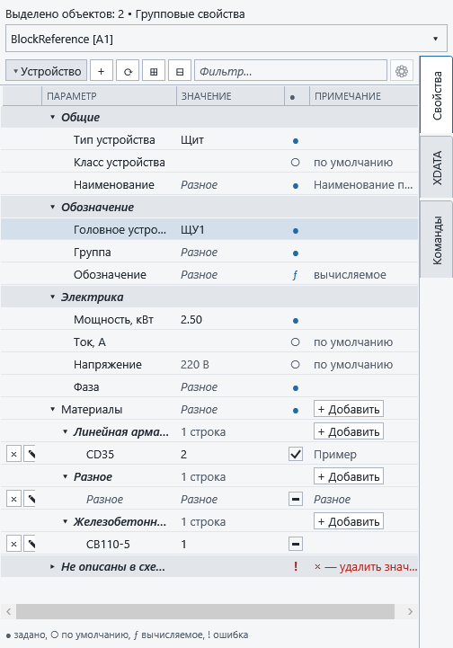 |

| Редактор с единицей `кВт` | Ошибка ввода `-1` | `✎` строки таблицы, ячейка «Кол.» |
| --- | --- | --- |
| 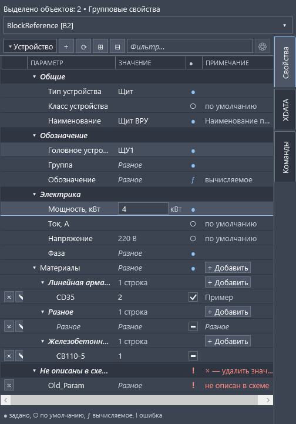 | 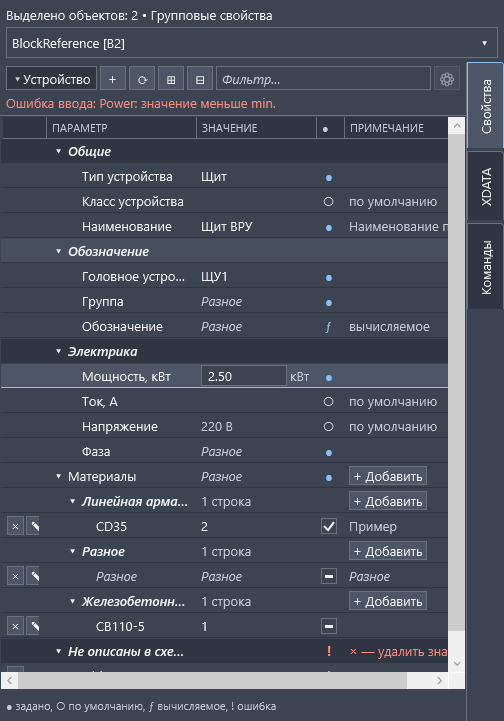 | 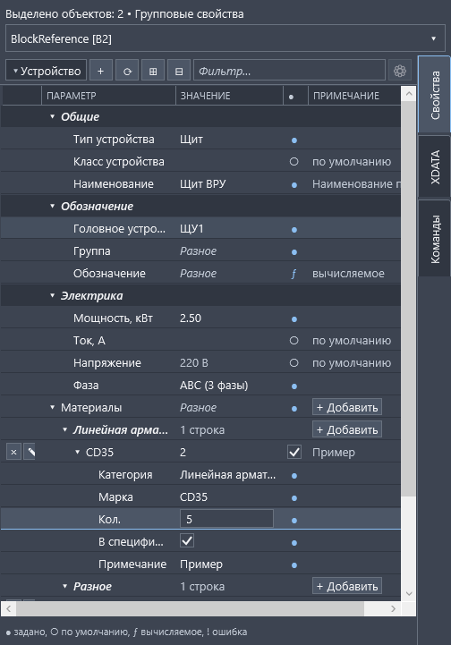 |

| Меню «+ Параметр» | Ошибка записи |
| --- | --- |
| 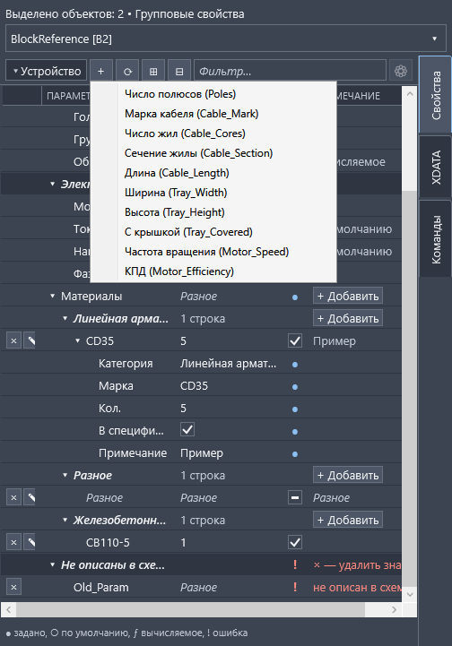 | 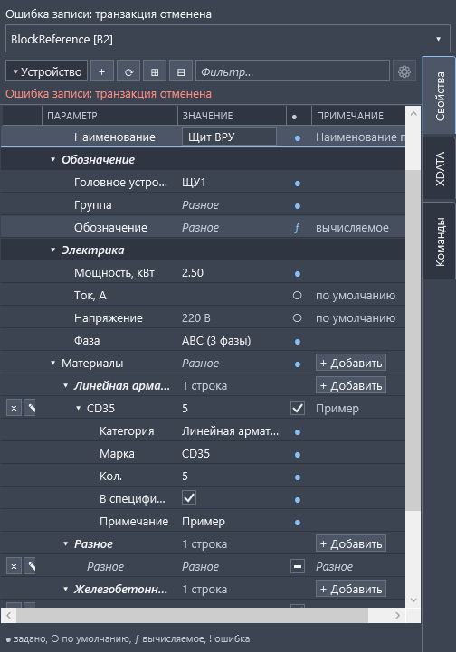 |

| Пустое выделение | Фильтр | Виртуализация, 400+ строк |
| --- | --- | --- |
| 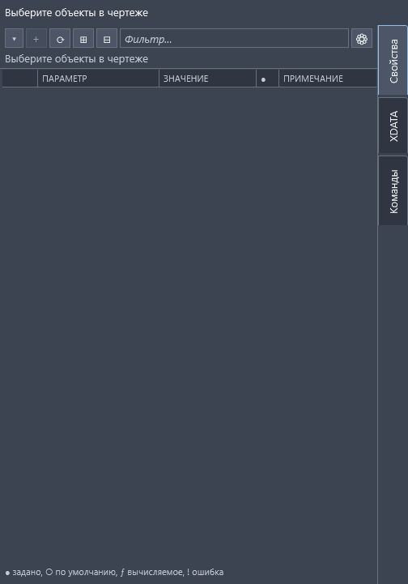 | 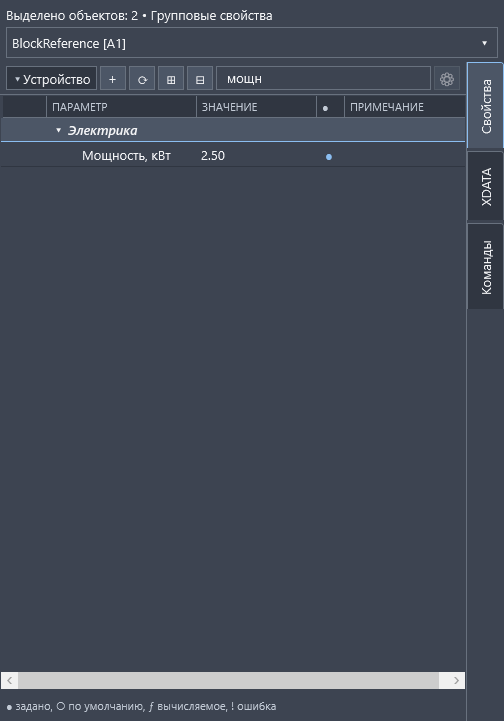 | 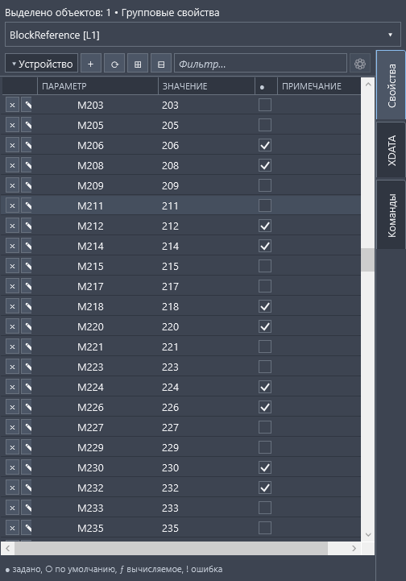 |

| Без шаблона | Прежний формат: только чтение | Минимальный размер 280 × 320 |
| --- | --- | --- |
| 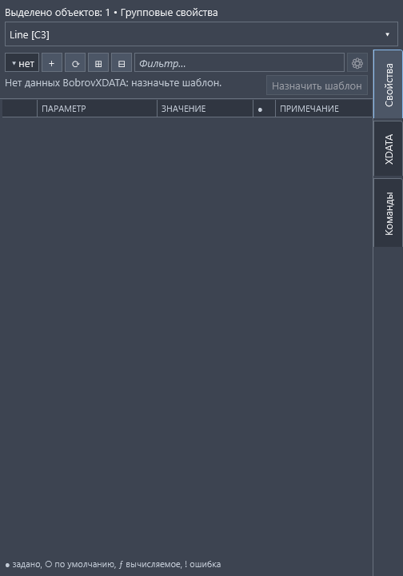 | 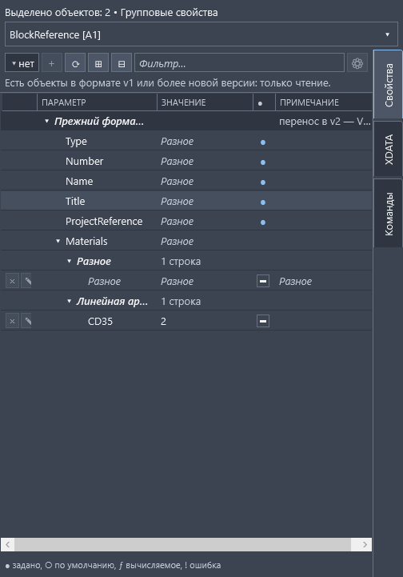 | 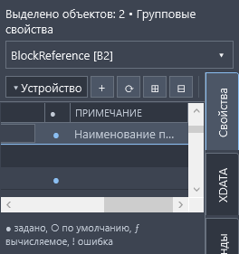 |

Smoke этапа 6 проверяет: редактор только у выделенной строки; Enter без ввода не пишет «Разное»,
ввод + Enter пишет все объекты; Esc; красную ошибку ввода; запись `Enum` из списка;
трёхпозиционный флажок; `✎` и запись ячейки; `+ Добавить` с курсором в ключе и `×`; меню
«+ Параметр» и запись выбранного параметра; ошибку записи с сохранением значений и выделения.
Рендер меню собран из палитры и всплывающего окна `ContextMenu`.

## TZXDATA, этап 5: VST вкладки «Свойства»

`tzxdata-stage5-*.png` получены из настоящего `PropertyGridView` внутри `PaletteView` на Windows
**net48**. Источник: [CI, commit f2cb14b](https://github.com/veb86/acadPaletteSetXDATA/actions/runs/38896199609),
артефакт `wpf-renders/net48`; те же проверки пройдены на .NET 8. Данные — кэш значений по схеме
[`examples/schema.json`](../../examples/schema.json), AutoCAD в CI не запускается. Описание VST —
[vst.md](../vst.md).

| Тёмная тема, 2 объекта | Светлая тема, 2 объекта |
| --- | --- |
| 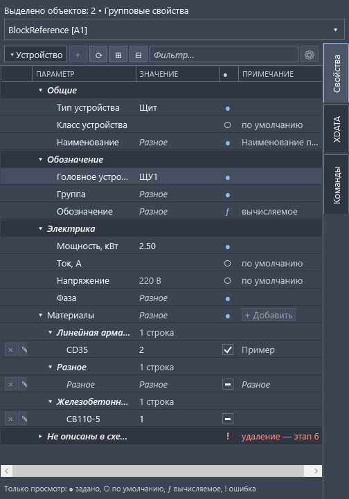 | 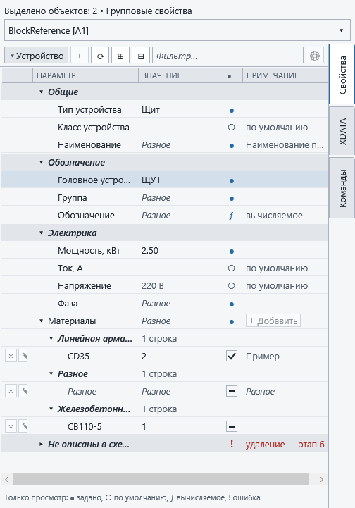 |

| Пустое выделение | Фильтр | Виртуализация, 400+ строк |
| --- | --- | --- |
| 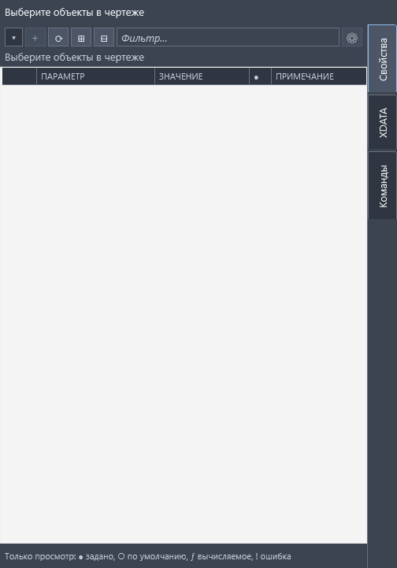 | 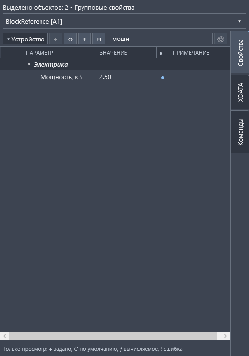 |  |

| Без шаблона | Прежний формат | Минимальный размер 280 × 320 |
| --- | --- | --- |
|  |  |  |

Smoke проверяет колонки раздела 8.2, группы и категории таблиц, состояния `●/○/ƒ/!`, «Разное»
серым курсивом, трёхпозиционный флажок, `⟳`/`⊞`/`⊟`, фильтр, меню колонок, сохранение раскрытия
и прокрутки по шаблону, отсутствие ошибок привязок и виртуализацию: видимых контейнеров
`ListViewItem` меньше числа строк.

## Задача #15: панель из единственной Release DLL

`issue15-release-dark.png` / `issue15-release-light.png` получены из WPF-панели,
скомпилированной внутри `acadPaletteSetXDATA.dll`, на Windows **net48**.
Источник: [Release CI, commit 9123f5c](https://github.com/veb86/acadPaletteSetXDATA/actions/runs/37636859030),
артефакт `release-wpf-renders`. Полный smoke-сценарий проверяет шаблоны моделей,
темы, вкладки, дерево и редактирование с теми же общими исходниками, что и отдельная UI DLL.
Собранный ZIP содержит только `acadPaletteSetXDATA.dll`; регистрация `XDATAPALETTE`
проверяется по её метаданным.

| Тёмная тема из Release DLL | Светлая тема из Release DLL |
| --- | --- |
|  |  |

Источник данных — снимки двух объектов. AutoCAD в CI не установлен: нативная рамка
PaletteSet, сообщение `NETLOAD` и запуск команды в AutoCAD проверяются отдельно по
[сценарию](../autocad-verification.md).

## Этап 5: запись общего поля с сохранением уникальных данных

`stage5-before.png` / `stage5-after.png` получены из настоящего WPF `UserControl`
на Windows **net48**, целевом runtime AutoCAD 2021. Источник:
[CI, commit 603ec39](https://github.com/veb86/acadPaletteSetXDATA/actions/runs/37540679249),
артефакт `wpf-renders/net48`. Те же проверки проходят на .NET 8.

| До: общий тип «Кабель» | После Enter: общий тип «Устройство» |
| --- | --- |
|  |  |

Поля названия/номера остаются «Разное», материалы сохраняют индивидуальные значения.
Сценарий использует настоящий `XDataWriter` с транзакцией в памяти; он проверяет
значения обоих снимков после ввода через настоящий ComboBox. Нативная рамка PaletteSet,
живая DWG и стек Undo AutoCAD в этих рендерах не участвуют.

## Этап 4: «Разное» и групповое редактирование

`stage4-*.png` получены из настоящего WPF `UserControl` на Windows **net48**,
целевом runtime AutoCAD 2021. Источник:
[CI, commit 0c7a3cb](https://github.com/konard/veb86-acadPaletteSetXDATA/actions/runs/37511644763),
артефакт `wpf-renders/net48`. Те же проверки проходят для .NET 8.
Источник данных — снимки с mock-записью через настоящий `XDataPatch`, без AutoCAD.

| До: отдельный объект, только чтение | После: общие свойства и Разное |
| --- | --- |
|  |  |

| Разное, светлая тема | Подтверждённые групповые изменения |
| --- | --- |
|  |  |

Проверяются настоящий ввод/подтверждение через Enter/фокус, отсутствие записи при
посещении поля без ввода, полная видимость плейсхолдера количества, сохранение фокуса
при вводе категории, перегруппировка после подтверждения, флаг и material add/rename/delete.
Нативная рамка PaletteSet и запись/Undo в живой DWG проверяются отдельно в AutoCAD.

## Этап 3: выбор и чтение XDATA/XRecord

`stage3-*.png` получены из настоящего WPF `UserControl` на Windows в режиме чтения.
Источник: [CI, commit 685632c](https://github.com/veb86/acadPaletteSetXDATA/actions/runs/37477965743),
артефакт `wpf-renders/net8`. Те же проверки выполняются на .NET Framework 4.8,
который используется целевой сборкой AutoCAD 2021. AutoCAD в CI не установлен:
рендеры используют снимки двух примитивов, без нативной рамки PaletteSet.

| Тёмная тема | Светлая тема |
| --- | --- |
|  |  |
|  |  |

| Без выделения: редактор неактивен | Один объект | XML XRecord |
| --- | --- | --- |
|  |  |  |

Проверка подписи выбранного объекта выявила отсутствие `SelectionBoxItemTemplate`
в общем шаблоне ComboBox. До исправления выводилось CLR-имя модели, после — тип
примитива и handle. Smoke-тест на commit `ef10578` воспроизводит ошибку;
проверка обеих подписей при смене объекта выполняется в обеих темах и платформах.

| До исправления подписи | После |
| --- | --- |
|  |  |

## Этап 2: свойства и материалы

`stage2-*.png` созданы настоящим WPF `UserControl` на Windows, включая пустой
черновик, три вкладки в обеих темах, раскрытый проект и узкую панель с прокруткой.
В обычных изображениях инструмент предпросмотра использует демонстрационные
материалы из изображения ТЗ; сам плагин начинает с пустого черновика.

Источник: [CI, commit ad6f6fe](https://github.com/konard/veb86-acadPaletteSetXDATA/actions/runs/37452804483),
артефакт `wpf-renders/net8`. Тот же сценарий проверяет .NET Framework 4.8.
Генератор: `experiments/AcadPaletteSetXData.WpfSmoke`; команды — в основном README.
Изображения показывают WPF-содержимое без нативной рамки AutoCAD.

| Тёмная тема | Светлая тема |
| --- | --- |
|  |  |
|  |  |
|  |  |

| Пустой черновик | Ссылка на проект | Минимальный размер, прокрутка |
| --- | --- | --- |
|  |  |  |

## Этап 1: исходный каркас

Изображения `stage1-<тема>-<вкладка>.png` созданы настоящим WPF `UserControl`
на Windows, а не отдельным макетом. Индексы вкладок: `0` — «Свойства»,
`1` — «XDATA», `2` — «Команды». Здесь сохранены рендеры .NET 8; тот же сценарий
успешно выполнен и на .NET Framework 4.8.

Источник: [CI, commit 378f034](https://github.com/konard/veb86-acadPaletteSetXDATA/actions/runs/37442186241),
артефакт `wpf-renders/net8`. Генератор: `experiments/AcadPaletteSetXData.WpfSmoke`.
Изображения показывают только содержимое палитры, без нативной рамки AutoCAD.

| Тёмная тема | Светлая тема |
| --- | --- |
|  |  |
|  |  |
|  |  |
