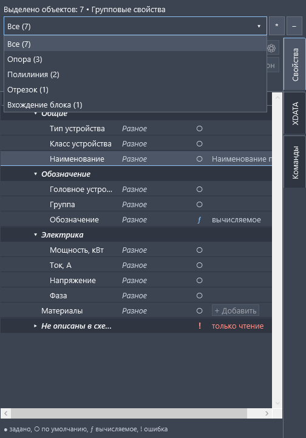

# Список выделенных объектов и кнопки `*` / `−` (задача #41)

Над вкладками панели — выпадающий список, который группирует текущее выделение AutoCAD
(`PICKFIRST`), и две кнопки справа от него.

## Имя группы

Для каждого объекта выделения имя группы:

1. непустое значение параметра `SYSTEMTYPE` в XDATA, если оно есть;
2. иначе — непустое значение `SYSTEMTYPE` из **шаблона** объекта (`TEMPLATE`), если шаблон содержит
   этот параметр (см. ниже);
3. иначе — имя типа объекта, которое возвращает **AutoCAD** в текущей локализации
   (то же, что показывает палитра «Свойства»: в русской версии «Полилиния», «Отрезок»,
   «Вхождение блока», в английской — «Polyline», «Line», «Block Reference»).

`SYSTEMTYPE` читается только для чтения, в любом из форматов, которые понимает палитра:

| Формат | Пример |
| --- | --- |
| XDATA v2 `BobrovXDATA` | `(1001 . "BobrovXDATA") (1070 . 2) … (1000 . "SYSTEMTYPE") (1000 . "Опора")` |
| строки `ключ=значение` (v1, ESMT и др.) | `(1000 . "SYSTEMTYPE=Опора")` |
| отдельный RegApp | `(1001 . "SYSTEMTYPE") (1000 . "Опора")` |

Сначала проверяются RegApp `BobrovXDATA` и `BobrovXDATA_V1`, затем шаблон объекта, затем остальные
RegApp. `Id` сравнивается без учёта регистра, значение обрезается по краям; пустое или из пробелов
считается отсутствующим.

### `SYSTEMTYPE` из шаблона

Объект с `(1000 . "TEMPLATE") (1000 . "CABLE")` в `BobrovXDATA` может не хранить `SYSTEMTYPE`: значение
по умолчанию шаблона показывается во вкладке «Свойства» с `○` и не записывается в XDATA (TZXDATA 6.2).
Список групп берёт то же значение, что и вкладка «Свойства», из схемы чертежа (NOD):

| Шаблон объекта | Имя группы |
| --- | --- |
| `{ "id": "SYSTEMTYPE", "default": "Кабель" }` в `parameters` шаблона | «Кабель» — `Default` шаблона |
| `"SYSTEMTYPE"` в `parameters` шаблона без `default`, у параметра `"default": "Труба"` | «Труба» — `Default` параметра |
| `SYSTEMTYPE` сохранён в XDATA объекта | сохранённое значение (шаблон не учитывается) |
| `SYSTEMTYPE` нет в `parameters` шаблона, шаблона нет в схеме или у объекта нет шаблона | имя типа AutoCAD (`Default` параметра без шаблона не используется) |

`SYSTEMTYPE` шаблона только читается: значения по умолчанию в XDATA не записываются, кнопки `*` и `−`
по-прежнему меняют только выделение. Список перестраивается при каждом чтении выделения, поэтому
назначение или смена шаблона (`VELEC_TEMPLATE_APPLY`, «Шаблон ▾»), импорт схемы и правка `SYSTEMTYPE`
сразу меняют группы.

Имя типа плагин получает вызовом
`Autodesk.AutoCAD.Internal.PropertyInspector.ObjectPropertyManagerProperties.GetDisplayName(DBObject)`
из `AcMgd.dll` (есть в AutoCAD 2021–2025). Собственных словарей, переводов и заранее заданных строк
нет. Только если AutoCAD не вернул имя (исключение или пустая строка), объект попадает в группу
по имени его .NET-класса, чтобы не пропасть из списка; это сообщение пишется в `Trace`
(и в командную строку при `XDATAPALETTE_TRACE=1`).

Группы одинаково строятся для отрезков, полилиний, вхождений блоков и любых других объектов.

## Список

- Группировка — по итоговому имени (с учётом регистра): объекты с `SYSTEMTYPE` «Опора» разных
  типов — одна группа; полилинии без `SYSTEMTYPE` — группа «Полилиния».
- Пункт — `Имя (N)`. Группы идут по убыванию количества, при равенстве — в порядке выделения.
- `Все (N)` — первым пунктом и только когда групп больше одной.
- Выбранная группа сохраняется, пока группа с тем же именем есть в новом выделении; иначе
  выбирается первый пункт. Без выделения список и кнопки скрыты.
- Список перестраивается при каждом изменении выделения в AutoCAD и после `*` / `−`.

## Кнопки

| Кнопка | Группа | `Все` |
| --- | --- | --- |
| `*` | оставить выделенными только объекты группы | ничего не делает |
| `−` | снять выделение с объектов группы, остальные остаются | снять всё выделение |

Кнопки меняют только набор `PICKFIRST` стандартными средствами AutoCAD: `Editor.SelectImplied()`
читает текущий набор, `Editor.SetImpliedSelection(ObjectId[])` задаёт новый (пустой массив снимает
выделение) под `Document.LockDocument()`. XDATA, `SYSTEMTYPE`, геометрия и свойства объектов не
изменяются, транзакций записи нет. Ошибка показывается в строке состояния над списком.

Список объектов для дерева XDATA перенесён во вкладку «XDATA» (над деревом); вкладка «Свойства»
по-прежнему редактирует всё выделение.

## Код

- `Core/SelectionGroups.cs` — `SelectionGroups.Build`/`DisplayName`/`SystemType`/`TemplateSystemType`,
  `SelectionGroup`, `ISelectionChanger`.
- `Core/SelectionViewModel.cs` — `Groups`, `SelectedGroup`, `KeepGroupCommand`, `ExcludeGroupCommand`;
  группы строятся по `ObjectCalculation` выделения (значения кэша с шаблоном и умолчаниями).
- `Core/SelectionController.cs` — применяет `SelectionChangeRequested` через `ISelectionChanger`
  и перечитывает выделение.
- `AutoCAD/AutoCadSelectionSource.cs` — `GetDisplayName` и `SetImpliedSelection`.
- `UI/PaletteView.xaml` — `SelectedGroupField`, `KeepGroupButton`, `ExcludeGroupButton`.

Тесты — `tests/AcadPaletteSetXData.Core.Tests/SelectionGroupsTests.cs` (`SYSTEMTYPE` шаблона —
`SystemTypeOfTheTemplateNamesTheGroup`, `AStoredSystemTypeWinsOverTheTemplateAndTheTemplateOverAForeignRegApp`,
`KeepAndExcludeUseTheSystemTypeOfTheTemplate`, `TheExampleSchemaGroupsTheFixtureOfTheManualCheck`); WPF-проверка
`VerifySelectionGroups` в `experiments/AcadPaletteSetXData.WpfSmoke`. Ручная проверка в AutoCAD —
[autocad-verification.md](autocad-verification.md#список-выделенных-объектов-задача-41).
