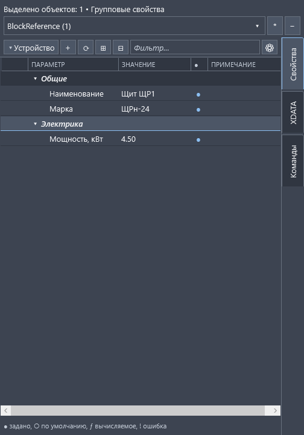
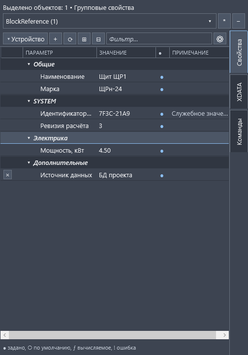
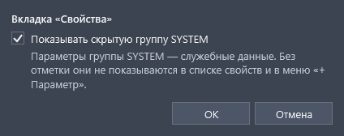
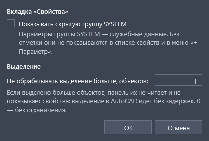
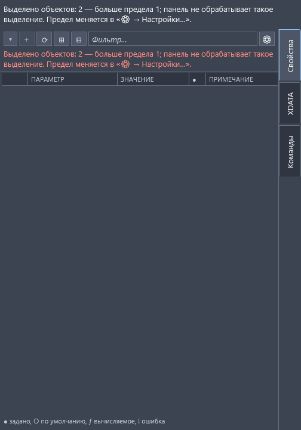
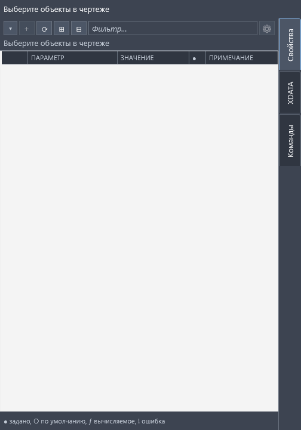
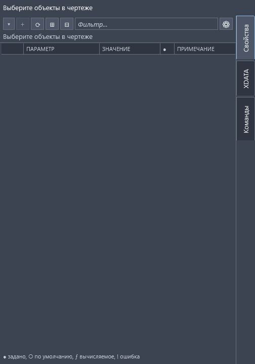
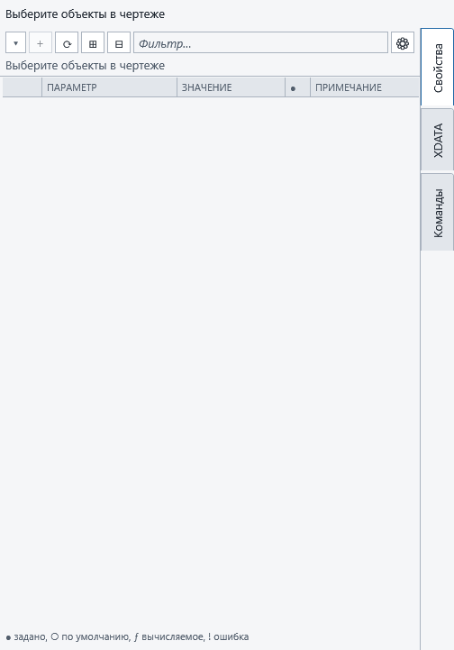

# Общие настройки панели и скрытая группа `SYSTEM` (задача #48)

## Скрытая группа `SYSTEM`

Параметры группы схемы **`SYSTEM`** (поле `group` параметра, раздел 4.1) — служебные данные: по
умолчанию вкладка «Свойства» их не показывает. Скрываются:

- строки параметров группы `SYSTEM` — и из шаблона объекта, и сохранённые в XDATA вне шаблона
  (в группе «Дополнительные» их тоже нет);
- сама группа `SYSTEM` в VST;
- пункты меню «+ Параметр».

Имя группы сравнивается без учёта регистра и пробелов по краям: `SYSTEM`, `system`, ` System `.
Значения в XDATA не меняются: скрытие касается только отображения. Остальные группы, «Не описаны в
схеме (N)» и «Прежний формат» показываются как раньше.

Пример схемы с тремя параметрами `SYSTEM` — [examples/issue48-system-group-schema.json](../examples/issue48-system-group-schema.json).

| Скрыта (по умолчанию) | Показана |
| --- | --- |
|  |  |

## Окно «Настройки панели XDATA»

Кнопка «⚙» справа на панели управления вкладки «Свойства» → «Настройки…». Кнопка доступна всегда;
пункты схемы («Редактор схемы…», «Импорт JSON…», «Экспорт JSON…») без AutoCAD недоступны, как раньше.

| Тёмная тема | Светлая тема |
| --- | --- |
|  |  |

- Флажок **«Показывать скрытую группу SYSTEM»** (по умолчанию снят).
- «ОК» (Enter) применяет флажок: VST перестраивается сразу, без нового выделения, и настройки
  записываются в файл. «Отмена» (Esc) и крестик ничего не меняют.
- Окно модальное (`Application.ShowModalWindow` в AutoCAD) и открывается в теме панели
  (`COLORTHEME`).

### Файл настроек

`%APPDATA%\AcadPaletteSetXData\settings.json` — свой у каждого пользователя Windows:

```json
{ "showSystemGroup": true, "maxSelectionCount": 15000 }
```

- Файл читается при создании панели. Нет файла, ошибка JSON или неверный тип значения — настройки
  по умолчанию; панель открывается в любом случае.
- `maxSelectionCount` (задача #59) — целое число ≥ 0; дробное, отрицательное, слишком большое или
  другого типа значение даёт 15000.
- Запись идёт через временный файл `settings.json.tmp`. Если папка недоступна для записи, в командной
  строке AutoCAD появляется сообщение, а настройка действует до закрытия AutoCAD.
- Неизвестные свойства файла (из новых версий плагина) сохраняются при записи.

## Выделение: закрытая панель и предел количества объектов (задача #59)

### Закрытая панель не участвует в выделении

Раньше панель после первого `XDATAPALETTE` оставалась подписанной на `ImpliedSelectionChanged`,
`CommandEnded`/`CommandCancelled`/`CommandFailed` документа и на `Application.Idle` — и читала каждое
выделение, даже когда была закрыта. Теперь:

- панель следит за выделением, только пока открыта. `XDATAPALETTE` и крестик в заголовке
  (событие `PaletteSet.StateChanged`, `Show`/`Hide`) включают и выключают `SelectionController.Active`;
- у закрытой панели `AutoCadSelectionSource.Tracking` выключен: все обработчики событий AutoCAD сняты,
  выделение объектов идёт так же, как без плагина. Содержимое панели очищается;
- при открытии панели текущее выделение читается сразу.

### Предел количества выделенных объектов

Поле **«Не обрабатывать выделение больше, объектов»** окна «Настройки панели XDATA» — по умолчанию
**15000**, `0` — без ограничения. Перед чтением панель только считает объекты набора PICKFIRST
(`Editor.SelectImplied`, объекты не открываются). Если их больше предела, панель:

- не читает объекты, XDATA и схему, не строит VST и список групп;
- показывает «Выделено объектов: N — больше предела 15000; панель не обрабатывает такое выделение.
  Предел меняется в «⚙ → Настройки…»» над панелью и в строке сообщений VST;
- ничего не записывает: кнопок «*»/«−» и правки значений нет, как без выделения.

Выделение ровно из предела читается как обычно. Новый предел применяется к текущему выделению сразу
после «ОК». В поле можно ввести целое число от 0 до 2147483647, пробелы между разрядами («15 000»)
допускаются; при другой строке под полем появляется ошибка, и «ОК» окно не закрывает.

| Окно настроек | Выделение больше предела |
| --- | --- |
|  |  |

Трассировка `XDATAPALETTE_TRACE=1` пишет «Отслеживание выделения включено/выключено» и «Объектов в
выделении: N» перед каждым чтением.

## Фон пустого списка в тёмной теме

Без выделения VST вкладки «Свойства» и дерево вкладки «XDATA» неактивны (`IsEnabled = false`).
Стандартные шаблоны WPF `ListView` и `TreeView` для этого состояния рисуют фон системным цветом
`SystemColors.ControlBrush`, поэтому в тёмной теме AutoCAD поле было белым. Стили `ThemedListView` и
`ThemedTreeView` (`Themes/Controls.xaml`) рисуют фон цветом темы `PaletteBackground` в любом состоянии.
Для `ListView` шаблон сохраняет `GridView.GridViewScrollViewerStyleKey`, поэтому заголовки колонок
работают как раньше.

| До (тёмная тема) | После (тёмная тема) | После (светлая тема) |
| --- | --- | --- |
|  |  |  |

## Файлы

| Файл | Что делает |
| --- | --- |
| `src/AcadPaletteSetXData.Core/PaletteSettings.cs` | Настройки, `IsSystemGroup`, `MaxSelectionCount`, JSON, чтение и запись файла. |
| `src/AcadPaletteSetXData.Core/SelectionController.cs` | `Active`, `ISelectionTracker`, `ISelectionCounter`: закрытая панель не читает выделение, выделение больше предела не читается. |
| `src/AcadPaletteSetXData.Core/SelectionViewModel.cs` | `ApplyOverLimit`, `SkippedCount`, сообщение о пределе. |
| `src/AcadPaletteSetXData.AutoCAD/AutoCadSelectionSource.cs` | `Tracking` (подписка на события AutoCAD), `CountSelection`. |
| `src/AcadPaletteSetXData.Core/PropertyGrid.cs` | `IsHidden`: VST и «+ Параметр» пропускают группу `SYSTEM`; изменение настройки перестраивает VST. |
| `src/AcadPaletteSetXData.UI/SettingsWindow.xaml(.cs)` | Окно настроек: черновик, «ОК»/«Отмена», тема. |
| `src/AcadPaletteSetXData.UI/PropertyGridView.xaml(.cs)` | Пункт «Настройки…» меню «⚙». |
| `src/AcadPaletteSetXData.UI/Themes/Controls.xaml` | `ThemedListView` и `ThemedTreeView`: фон темы в неактивном состоянии. |
| `src/AcadPaletteSetXData.AutoCAD/AutoCadPaletteHost.cs` | Чтение и запись `settings.json`, `ShowModalWindow`; `Visible` и `PaletteSet.StateChanged` включают и выключают отслеживание выделения. |

## Проверка

- `SystemGroupTests` (Linux CI): скрытие и показ группы в VST и в «+ Параметр», регистр имени группы,
  JSON и битые файлы, черновик окна, запись и чтение файла.
- WPF smoke (Windows CI, net48 и net8): фон пустых VST и дерева XDATA — шаблон и пиксели рендера в тёмной и
  светлой темах; меню «⚙» без AutoCAD и с ним; окно настроек в `ShowDialog` — флажок, «ОК», «Отмена»,
  тема и владелец окна; строки `SYSTEM` до и после. Рендеры `issue48-*.png`.
- `SelectionLimitTests` (Linux CI, задача #59): закрытая панель не читает выделение и не пишет,
  источник перестаёт следить за выделением; предел по умолчанию 15000, выделение больше предела
  считается, но не читается; новый предел применяется сразу; JSON и разбор поля окна.
- WPF smoke (Windows CI, задача #59): поле предела в окне настроек, ошибка ввода, «ОК», сообщение
  панели, скрытая панель. Рендеры `issue59-*.png`.
- Ручная проверка в AutoCAD — [autocad-verification.md](autocad-verification.md#скрытая-группа-system-и-настройки-задача-48),
  [задача #59](autocad-verification.md#закрытая-панель-и-предел-выделения-задача-59).
